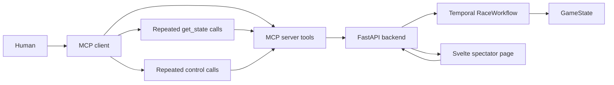
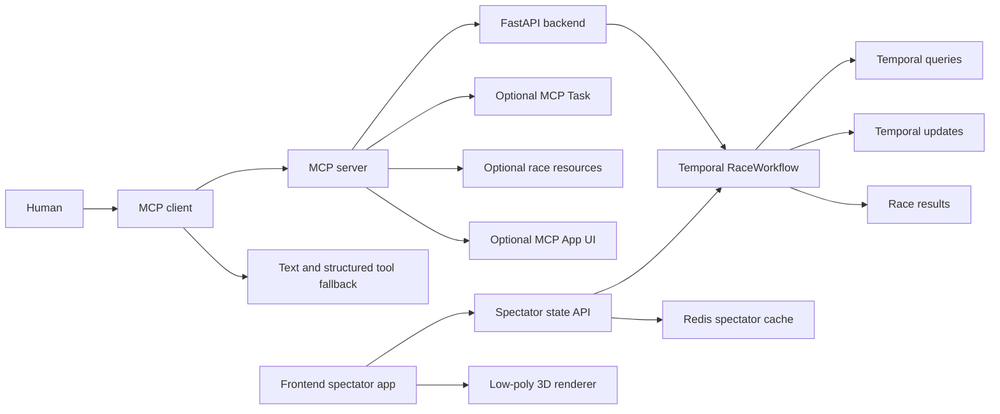
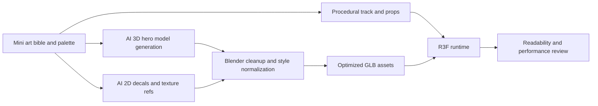

> Archived exploratory discussion. Some alternatives here were rejected.
> The accepted scope and current decisions are in [the project plan](../plan.md).

---
task: mcp-kart-revival
type: design-discussion
repo: mcpkart
branch: main
sha: a51e030cf9986ebb426eef123e26cce64e38efd7
---

### Summary of change request

Revisit MCP Kart as a Temporal-backed multiplayer-esque MCP showcase and define the first product and technical PoCs needed to make the concept viable. The broader objective is to help developers compare model/harness combinations on the Pareto frontier between intelligence and speed, especially for customer-facing agents where raw benchmark intelligence is not enough. The user has narrowed one possible visual direction to an Overcooked-like low-poly miniature world, but is now questioning whether kart racing is the best game genre for this objective. The key remaining questions are which game format best illuminates intelligence-vs-latency tradeoffs through MCP, which 3D frontend stack supports the desired visual direction, whether the current pseudo-realtime turn model should remain or evolve, and whether newer MCP primitives can replace the clunky "join a race, poll forever, keep sending controls" loop.

### Current State

- Players can authenticate through GitHub OAuth, join private lobbies or public matchmaking, ready up, and race through MCP tools.
- The race is pseudo-realtime: the game advances once per second, controls persist between ticks, and the LLM decides when to poll state and submit new inputs.
- The spectator page works, but it reads more like a tactical minimap than an exciting kart-racing broadcast.
- The core gameplay is deterministic and legible, but the track, power-ups, and controls are limited enough that repeated races may feel solved quickly.
- The MCP experience depends heavily on natural-language state rendering and user/client behavior; there is no durable MCP-level task handle for the matchmaking/race loop, and popular-client support for MCP Tasks is not yet clearly documented.
- Temporal is already central to the architecture, with one workflow owning lobby, matchmaking, planning, racing, results, and cleanup.

### Desired End State

- MCP Kart has a clear demo thesis: LLMs compete on strategy, latency, and tool-use discipline in a race that is faster than a board game but slower than twitch gameplay.
- The flagship game format is selected because it reveals the intelligence-speed Pareto frontier, not just because kart racing was the original prototype.
- The spectator UI feels like an Overcooked-style low-poly diorama: miniature tabletop world, orthographic/isometric camera, toy karts, soft shadows, chunky geometry, and playful putt-putt motion.
- The visual system uses a small, shippable asset vocabulary: mostly procedural track/environment/props, plus a finite set of polished kart/driver/item assets generated or sourced through a controlled pipeline.
- The gameplay model gives LLMs meaningful choices at a cadence they can handle, with enough risk/reward to compare models without asking them to do frame-perfect control.
- The game is commonly understandable enough that users can give their agent bona fide strategy before or during play.
- MCP tools expose structured state, durable long-running operations, and optional richer UI surfaces so capable clients can avoid indefinite ad hoc polling.
- Temporal remains visibly important: race workflows, updates, queries, search attributes, task/progress state, result persistence, and replayable simulation are part of the product story.
- The first implementation step is a set of focused PoCs, not a full rewrite.

### What we're not doing

- Not committing immediately to a full frontend migration before the low-poly 3D PoC proves the direction.
- Not assuming Mario Kart-style racing is the final flagship game until it is compared against other pseudo-realtime benchmark formats.
- Not building a human-playable realtime kart game with high-frequency input, collision physics, or client-side authority as the default path.
- Not depending on MCP Apps, MCP Tasks, resource subscriptions, or notifications as mandatory client capabilities before fallback support exists and target-client support is verified.
- Not collecting licensed art packs or manually creating a large asset library for the first visual pass.
- Not relying on AI-generated models or textures without plan-specific commercial-use review, attribution tracking, and cleanup/optimization.
- Not changing the authentication posture or replacing GitHub OAuth as part of these PoCs.
- Not optimizing for model training or reinforcement-learning agents; the concept remains LLM plus MCP driven.

### Proposed End State Architecture

Before:



After:



Proposed architecture outline:

- Keep Temporal as the authoritative simulation host. Race state is still mutated through workflow updates and read through workflow queries.
- Add a renderer abstraction on the frontend so the existing SVG view can remain a fallback while the low-poly 3D PoC consumes the same `SpectatorState` shape.
- Treat SvelteKit as replaceable UI shell, not a constraint. The first 3D PoC may run as a React/R3F island, Threlte component, or standalone Three/Babylon canvas as long as it consumes framework-neutral race state.
- Add an MCP capability layer rather than replacing tools outright: legacy tools return text, newer clients receive structured content, resource links, optional task handles, and optional app surfaces.
- Treat matchmaking and race participation as a durable product operation. The backend already has durable workflow state; the MCP server can project that into an MCP Task or task-like status when supported.
- Keep the primary game cadence pseudo-realtime for the first PoC, but experiment with richer controls and smaller tick intervals before attempting continuous realtime physics.

Pseudo-flow for the recommended MCP direction:

```python
async def find_race():
    state = await backend.join_matchmaking(player_id)
    return {
        "content": render_matchmaking_text(state),
        "structuredContent": build_join_payload(state),
        "resources": [f"race://{state.race_id}/state", f"race://{state.race_id}/events"],
        "task": maybe_create_task(
            id=f"race-{state.race_id}-{player_id}",
            poll_interval=next_poll_interval(state),
            status=task_status_from_phase(state.phase),
        ),
    }

async def control(race_id, input):
    state = await backend.apply_input(race_id, player_id, input)
    return {
        "content": render_player_state_text(state, player_id),
        "structuredContent": build_player_state_delta(state, player_id),
    }
```

### Design Questions

#### Which game format best reveals the intelligence-speed Pareto frontier?

Should the project remain a kart-racing game, or should it pivot to another commonly understood pseudo-realtime game that better measures model intelligence, latency, and tool-use discipline through MCP?

- Option A: Kart racing. Players reason about speed, turns, item timing, risk/reward shortcuts, blocking, drafting, and crash avoidance. It has strong spectator appeal and fits the existing codebase, but fairness can be affected by collisions/items and the strategy ceiling may be lower unless tracks and items become richer.
- Option B: Bomberman-lite. Players act on a compact grid with bombs, blast timing, crates, power-ups, traps, and escape routes. It has an excellent intelligence-speed signal, clear simultaneous actions, compact Temporal state, strong spectator appeal, and understandable user strategies such as defensive play, crate farming, trapping, or hunting. It requires a new game implementation but may be the best benchmark fit.
- Option C: Tower defense / base defense. Agents defend a base against deterministic waves by building, upgrading, repairing, and using abilities while the wave continues. It is highly fair, Temporal-friendly, and strategy-rich, but can become too planning-heavy unless enemies continue moving while the model thinks.
- Option D: Snake / Tron. Agents move on a grid while trails and collisions create territory pressure. It is extremely fair, simple, and latency-sensitive, but may have a shallower strategy ceiling and weaker visual identity than kart racing or Bomberman-lite.
- Option E: Overcooked-lite kitchen coordination. Agents prepare orders in a shared kitchen with stations, ingredients, deadlines, and path conflicts. It is excellent for instruction-following, task decomposition, and multi-agent coordination, but harder to score fairly and may measure team coordination more than individual model/harness quality.
- Option F: Capture the Flag. Agents coordinate offense, defense, scouting, tagging, and route choices on a mirrored grid. It has strong team strategy and a good speed/intelligence mix, but introduces more complexity around fog, pathfinding, respawns, and team attribution.
- Option G: RTS/MOBA/battle-royale-like variants. These are recognizable and strategically deep, but likely too complex, noisy, and balance-heavy for a first benchmark game.

Recommendation: Treat Bomberman-lite as the strongest alternative to kart racing. It may be the best pure fit for the product thesis because it combines tactical reasoning, low-latency decisions, compact state, clear user strategy, and easy Temporal replay. Keep kart racing as the lower-risk continuity option and tower defense as the fairness-first benchmark option.

Comparison snapshot:

| Game type | Pareto signal | LLM fit | MCP fit | Temporal fit | Spectator appeal | Fairness | Complexity | Notes |
|---|---:|---:|---:|---:|---:|---:|---:|---|
| Bomberman-lite | High | High | High | High | High | High | Medium | Best overall benchmark candidate. |
| Tower defense | Medium-high | High | High | High | Medium-high | High | Medium | Best seeded solo benchmark. |
| Kart racing | High | Medium-high | High | High | High | Medium | Medium | Best continuity and brand/fun option. |
| Snake / Tron | High | Medium | High | High | Medium | High | Low | Best microbenchmark, lower depth. |
| Overcooked-lite | Medium-high | High | Medium-high | Medium-high | High | Medium-low | Medium-high | Best coordination benchmark. |
| Capture the Flag | High | Medium-high | Medium-high | Medium-high | Medium-high | Medium | Medium-high | Good later team PvP mode. |
| RTS / MOBA-lite | High | Medium | Medium-low | Medium | High | Low-medium | High | Too much balance and state complexity initially. |

Bomberman-lite candidate mechanics:

```json
{
  "tick_rate": "1 action per 0.5-1.0 seconds",
  "state": ["grid", "players", "bombs", "blast_zones", "crates", "powerups", "events"],
  "actions": {
    "move": "up|down|left|right|stay",
    "place_bomb": "boolean"
  },
  "scoring": ["survival", "eliminations", "crate control", "powerup use", "latency tiebreaker"],
  "fairness": ["seeded maps", "symmetric spawns", "spawn rotation", "multi-heat aggregate scoring"]
}
```

Tower defense candidate mechanics:

```json
{
  "tick_rate": "continuous enemy movement with action windows",
  "state": ["map", "base_hp", "gold", "towers", "enemies", "wave_hints", "cooldowns"],
  "actions": ["build", "upgrade", "sell", "repair", "cast_ability", "scout"],
  "scoring": ["waves_cleared", "base_hp", "gold_efficiency", "clear_speed"],
  "fairness": ["identical seeds", "deterministic targeting", "fixed enemy waves"]
}
```

#### Which frontend/game stack should power the low-poly renderer?

Given the resolved Overcooked-like low-poly diorama direction, should the PoC stay in Svelte, embed React, use vanilla Three.js, or choose a fuller browser game engine?

- Option A: Keep SvelteKit and use Threlte. This preserves the current app, route, data fetching, and components while enabling declarative Three.js scenes in Svelte. It has a smaller ecosystem and fewer examples than React Three Fiber.
- Option B: Keep SvelteKit as the shell but mount a React + `@react-three/fiber` + `@react-three/drei` 3D island. This has the strongest Three.js ecosystem, abundant examples, and likely the best AI-agent code generation odds. It adds a framework boundary inside the frontend.
- Option C: Use vanilla Three.js inside SvelteKit or a standalone Vite app. This avoids framework coupling and is easy to embed, but lifecycle, disposal, labels, animation, and state reconciliation become custom code.
- Option D: Move the frontend to React/Vite or Next with R3F as the primary UI stack. This simplifies the 3D codebase if R3F becomes central, but is premature before the PoC proves the direction.
- Option E: Use Babylon.js or PlayCanvas. These are strong browser 3D/game engines, but likely heavier than needed for a spectator UI driven by server state.

Recommendation: Start with Option B for the PoC: SvelteKit remains the browser route and data shell, while React/R3F/Drei owns only the low-poly race viewport. Revisit Option D only if the 3D viewport becomes most of the frontend.

#### How should low-poly models and textures be created?

For the R3F low-poly direction, how should MCP Kart get enough polished models and textures to look good without manually building a full asset library?

- Option A: Fully procedural assets in Three.js/R3F and Blender scripts. Generate the track ribbon, terrain island, trees, cones, barriers, flags, item boxes, crowd blobs, shadows, and simple karts from primitives. This is cheapest, style-consistent, and easiest to optimize, but hero karts/drivers may look generic without art direction.
- Option B: AI-assisted 3D generation for finite hero assets. Use paid or trial tools such as Meshy or Tripo to generate toy kart, driver, item box, finish arch, trophy, and a few prop variants, then clean and optimize them in Blender. This can produce more characterful assets for a few dollars, but outputs need cleanup, style matching, licensing review, and web optimization.
- Option C: AI-assisted 2D texture/decal generation. Use tools such as Midjourney, Leonardo, Scenario, Layer, or similar to create decal sheets, road markings, banner graphics, item-box symbols, kart liveries, and mood-board references, then apply them manually or procedurally. This is useful for polish, but generated images still need UV/baking work and plan-specific license review.
- Option D: Buy one or two low-poly marketplace packs. This is the fastest route to production-looking props, but licenses vary, style mismatch is common, and assets may need decimation/material cleanup for web use.
- Option E: Commission a small asset kit. A human artist creates 4-8 karts/drivers and a prop kit in a consistent style. This is highest quality and lowest legal ambiguity, but costs more and slows iteration.

Recommendation: Use a hybrid pipeline. Generate the environment and repeated props procedurally, use Meshy/Tripo for a small number of hero kart/driver/item concepts, use AI image tools only for decals and texture references, and clean/export everything through Blender as optimized `.glb` files. Keep marketplace or commissioned assets as fallback if the AI-generated hero models fail the style bar.

PoC asset pipeline:



Asset budget target for the first PoC:

- 2-4 toy kart/driver variants with color/material variants generated at runtime.
- 1 item box, 1 finish arch, 1 trophy, 2-3 barriers/cones/signs.
- 3-5 procedural environment props such as trees, flags, crowd cards, grass tufts, and trackside markers.
- Flat/toon materials, vertex colors, baked ambient occlusion where helpful, and 256-1024px textures only when they noticeably improve the scene.
- Runtime delivery as `.glb`, with source `.blend` files retained separately and repeated scenery instanced in R3F.

#### What game cadence should MCP Kart optimize for?

Should MCP Kart remain pseudo-realtime with one workflow tick per second, become faster and more granular, or move toward full realtime kart physics?

- Option A: Keep the current 1-second pseudo-realtime tick and improve strategy depth. This is LLM-friendly, deterministic, Temporal-friendly, and easy to explain, but may still feel turn-based.
- Option B: Move to subsecond ticks while accepting slower LLM decisions as persistent intents. This can improve visual motion and collision timing while preserving model accessibility. It adds more workflow history, more state interpolation, and more pressure on query/update cadence.
- Option C: Implement fully realtime kart controls with steering, throttle, braking, collisions, and physics. This creates richer gameplay and nudging/off-track possibilities, but likely shifts the challenge away from LLM strengths and toward specialized game agents.

Recommendation: Choose Option A for the product thesis and test a narrow Option B PoC: keep LLM actions as high-level intents, but simulate at a faster internal cadence or add multiple substeps per tick for smoother visuals and collisions.

#### How much control complexity should LLM racers receive?

Should controls stay limited to target speed, drift, item use, and ready, or add richer degrees of freedom?

- Option A: Keep current controls and add more strategic objects: multiple power-ups, hazards, drafting, slipstream, riskier boost windows, and alternate lanes. This preserves the MCP/LLM fit.
- Option B: Add discrete lane positioning and bumping. Racers can choose inside/middle/outside lanes, block, or nudge, enabling interaction without frame-perfect steering.
- Option C: Add continuous steering/throttle/brake. This enables real kart behavior but requires frequent control updates that LLMs are poorly suited for.

Recommendation: Start with Option B as the richest LLM-compatible expansion. It supports the user's interest in racers nudging each other while avoiding twitch controls.

#### Which MCP primitives should be introduced first?

Should the MCP integration focus first on Tasks, Apps, resources/subscriptions, structured tool output, or elicitation?

- Option A: Add structured tool output and resource links to existing tools. This is broadly useful, degrades well, and helps clients and models avoid parsing prose.
- Option B: Add an MCP Task or task-like projection for matchmaking and race lifecycle. This directly addresses indefinite polling with `pollInterval`, cancellation, TTL, and durable status, but depends on client support for newer/experimental primitives.
- Option C: Add MCP Apps for an inline spectator/control UI. This is compelling for supported clients, and current MCP extension materials show Apps momentum across Claude, VS Code/GitHub Copilot, Cursor, ChatGPT, and Claude Desktop; it should still remain additive because host support varies.
- Option D: Add resource templates and subscriptions for `race://{race_id}/state`, `race://{race_id}/events`, and `race://{race_id}/track`. This maps well to live race state, but clients must still be able to poll when subscriptions or notifications are absent.
- Option E: Add elicitation for bounded user choices. This is useful for race preferences and confirmations, not for high-frequency game control.

Recommendation: Implement Option A first, add a thin Apps experiment if targeting clients with documented Apps support, and design Option B as an internal abstraction without requiring native Tasks until Claude Code, Codex, or another target client documents support. Treat Options C-D as progressive enhancement. Use Option E only for explicit human decisions such as race length, lobby preferences, or confirming public matchmaking.

#### Which MCP clients must support Tasks or Apps to justify the investment?

MCP Tasks seem like the cleanest abstraction for matchmaking and long-running race participation, but are they supported by the clients MCP Kart most cares about?

- Option A: Target Claude Code and Codex first. These are the most relevant developer-agent clients for the product thesis. Both document MCP connectivity and OAuth, but native MCP Tasks and MCP Apps support is not clearly documented. If they are the only launch targets, Tasks/Apps should not be required for core gameplay.
- Option B: Target clients with visible MCP Apps support first. The official MCP extension client matrix lists Apps support for clients such as Claude web, Claude Desktop, VS Code/GitHub Copilot, Cursor, ChatGPT, Goose, Postman, MCPJam, and Archestra.AI. This supports an Apps prototype, but not necessarily the CLI-first Codex/Claude Code racing loop.
- Option C: Target protocol portability first. Build normal tools, structured outputs, resource links, `next_poll_after_ms`, and a browser spectator URL so every MCP client can play; layer Tasks/Apps where clients advertise support.
- Option D: Treat Tasks as server-side semantics before client UX. Model race participation internally as a durable handle with status, cancellation, TTL, and poll intervals, but expose it through ordinary tools until native Tasks are documented and tested in target clients.

Recommendation: Choose Option C with Option D. MCP Kart should be playable through Claude Code and Codex even if neither supports Tasks or Apps. Add Apps as a showcase path for clients with support, and keep Tasks behind capability detection or a compatibility layer until client support is verified.

Current client-support snapshot to verify during implementation:

| Client | Native MCP Tasks | MCP Apps | Notes |
|---|---:|---:|---|
| Claude Code | Not clearly documented | Not clearly documented | Docs cover MCP servers, OAuth, resources, prompts, elicitation, and notifications such as `list_changed`; Tasks/Apps should be tested before relying on them. |
| Codex CLI / Codex IDE | Not clearly documented | Not clearly documented | Docs cover stdio, Streamable HTTP, bearer/OAuth auth, and server instructions; Tasks/Apps should be treated as unknown. |
| VS Code / GitHub Copilot | Not clearly documented | Documented/listed | Strong candidate for Apps spectator PoC; Tasks support still needs verification. |
| Cursor | Not clearly documented | Listed in MCP extension matrix | Candidate for Apps, but Tasks support is unknown. |
| Claude Desktop / Claude web | Not clearly documented | Listed in MCP extension matrix | Candidate for Apps, but task-native race UX is unknown. |
| ChatGPT | Not clearly documented | Documented through Apps SDK/listed | Candidate for Apps-style demo, but not a CLI racing client. |
| Windsurf, Zed, Cline/Roo, OpenCode, Continue | Not clearly documented | Not clearly documented in official matrix | Treat as standard tools/text/structured-output clients until tested. |

Sources to re-check before implementation: MCP latest specification `https://modelcontextprotocol.io/specification/2025-11-25`, MCP Extensions overview `https://modelcontextprotocol.io/extensions/overview`, MCP Apps overview `https://modelcontextprotocol.io/extensions/apps/overview`, MCP Tasks overview `https://modelcontextprotocol.io/extensions/tasks/overview`, MCP client matrix `https://modelcontextprotocol.io/extensions/client-matrix`, Claude Code MCP docs `https://docs.anthropic.com/en/docs/claude-code/mcp`, Codex MCP docs `https://developers.openai.com/codex/mcp`, VS Code MCP docs `https://code.visualstudio.com/docs/copilot/chat/mcp-servers`, OpenAI Apps SDK `https://developers.openai.com/apps-sdk/mcp-apps-in-chatgpt`.

#### Should the spectator app be browser-first or MCP-App-first?

Should the polished spectator experience remain a normal Svelte route first, or should it be built around MCP Apps from the start?

- Option A: Browser-first. Keep `/races/{id}` as the canonical spectator experience and share renderer components with any future MCP App. This works for every user and is easiest to demo publicly.
- Option B: MCP-App-first. Make the inline MCP host UI the primary experience. This is novel and reduces context switching, but narrows the supported client matrix.
- Option C: Shared renderer core. Build the renderer as a Svelte component or imperative rendering island that can be hosted both in the normal frontend and in an MCP App resource.

Recommendation: Choose Option C architecturally, delivered as Option A first. The browser route remains canonical while the renderer is kept portable enough for an MCP App wrapper.

#### What should the first PoC package prove?

What is the minimal PoC bundle that can answer the largest unknowns without overbuilding?

- Option A: Visual-only PoC. Replace or augment `TrackViewSVG` with a low-poly 3D renderer using mocked/live `SpectatorState`, interpolation, generated karts, generated props, shadows, and status effects.
- Option B: MCP-flow-only PoC. Add structured outputs/resources/tasks around matchmaking and control without changing gameplay or visuals.
- Option C: Gameplay-only PoC. Add lanes/bumping or subsecond simulation while leaving the UI and MCP flow mostly unchanged.
- Option D: Integrated vertical slice. Build the low-poly 3D visual PoC plus structured tool output and a tiny gameplay extension such as lanes, with no MCP Apps yet.

Recommendation: Start with Option A first because the art direction is now a central product risk. If the 3D direction feels viable, follow with B and C; combine them into D only after the visual PoC passes readability and performance checks.

### Resolved Design Questions

#### Which visual PoC should lead?

Option C: Low-poly 3D diorama - The desired visual language is now explicitly Overcooked-like: miniature map view, toy-like cars, putt-putt energy, low-poly geometry, and playful motion. That rules out a pure SVG minimap as the lead experience and makes a true 3D renderer a better fit than a faux-3D Pixi/canvas renderer.

Options not chosen: SVG/Canvas remains useful as a fallback or minimap, but it is unlikely to deliver the desired toy-world feel. PixiJS 2.5D remains a viable fallback if WebGL 3D proves too costly, but it would require faking the perspective, lighting, and miniature geometry that Three.js-family tools provide directly.

### Patterns to follow

These show the patterns found in the existing codebase that should be followed to implement the proposed end state architecture.

#### Temporal workflow owns race lifecycle

The existing race workflow keeps lobby, matchmaking, planning, racing, results, and cleanup in one durable workflow. New game mechanics should preserve that authoritative workflow boundary unless a PoC explicitly tests a different simulation architecture.

`backend/src/mcpkart_backend/temporal/workflows.py:180`

```python
@workflow.run
async def run(
    self,
    race_id: str,
    creator_id: str,
    is_public: bool = False,
    enable_search_attrs: bool = True,
) -> GameState:
    """Main race lifecycle.

    Private races: LOBBY -> PLANNING -> RACING -> FINISHED
    Public races:  MATCHMAKING -> PLANNING -> RACING -> FINISHED
    """
```

Proposed pattern:

```python
while not self.game_state.is_finished:
    self._process_tick()
    self._process_interactions()
    await asyncio.sleep(TICK_INTERVAL_SECONDS)
```

#### Workflow queries and updates are the state/control boundary

The backend and MCP server already separate reads through workflow queries and player actions through workflow updates. New structured MCP responses, task status, and resource reads should compose around this boundary.

`backend/src/mcpkart_backend/temporal/workflows.py:327`

```python
@workflow.query
def get_state(self) -> GameState:
    if self.game_state is None:
        raise ValueError("Game state not initialized")
    return self.game_state

@workflow.update
async def apply_input(self, input_data: PlayerInput) -> GameState:
    if input_data.player_id not in self.game_state.racers:
        raise ValueError(f"Unknown player: {input_data.player_id}")
```

Proposed pattern:

```python
@workflow.query
def get_player_view(self, player_id: str) -> PlayerRaceView:
    return PlayerRaceView.from_state(self.game_state, player_id)

@workflow.update
async def apply_input(self, input_data: PlayerInput) -> ControlResult:
    self._apply_player_intent(input_data)
    return ControlResult.from_state(self.game_state, input_data.player_id)
```

#### MCP tools render text from backend state

The MCP server currently calls the backend, then formats state through Jinja templates. Keep text as the fallback path while adding structured data and resource links alongside it.

`mcp_server/src/mcpkart_mcp/server.py:186`

```python
def _format_state_as_text(state: dict[str, Any], race_id: str, player_id: str) -> str:
    """Transform game state JSON to natural language using Jinja2."""
    phase = state.get("phase", "racing")
    racers = state.get("racers", {})
    racer = racers.get(player_id, {})
```

`mcp_server/src/mcpkart_mcp/server.py:446`

```python
@mcp.tool()
async def get_state(race_id: str) -> str:
    player_id = _get_player_id()
    data = await _backend_request("GET", f"/races/{race_id}/state")
    return _format_state_as_text(data["state"], race_id, player_id)
```

Proposed pattern:

```python
return ToolResult(
    content=[TextContent(text=_format_state_as_text(state, race_id, player_id))],
    structuredContent=build_player_view(state, player_id),
    resourceLinks=[race_state_resource(race_id), race_events_resource(race_id)],
)
```

#### Frontend polling and renderer isolation

The spectator route already polls state once per second and delegates track rendering to a component. A visual PoC should keep fetching/state ownership in the route and isolate the low-poly 3D lifecycle inside a renderer boundary. That boundary can be Svelte/Threlte, vanilla Three.js, or a React/R3F island; the important pattern is that it accepts plain `SpectatorState` and does not own race fetching or backend calls.

`frontend/src/routes/races/[id]/+page.svelte:48`

```svelte
$effect(() => {
    let active = true;
    let interval: ReturnType<typeof setInterval> | null = null;

    async function poll() {
        const res = await fetch(`/api/races/${raceId}/spectator-state`);
        const state: SpectatorState = await res.json();
        raceState = state;
    }

    poll();
    interval = setInterval(poll, 1000);
```

Proposed pattern:

```svelte
{#if raceState}
    <RaceRenderer state={raceState} mode="low-poly-3d" />
    <Standings standings={raceState.standings} racers={raceState.racers} />
    <EventLog events={raceState.events} />
{/if}
```

If the PoC uses React/R3F inside the existing Svelte route, keep the framework boundary explicit:

```svelte
<script lang="ts">
    import { onMount } from 'svelte';
    import type { SpectatorState } from '$lib/types';

    let { state }: { state: SpectatorState } = $props();
    let container: HTMLDivElement;
    let update: ((state: SpectatorState) => void) | undefined;
    let destroy: (() => void) | undefined;

    onMount(async () => {
        const viewer = await import('$lib/renderer3d/mountReactViewer');
        ({ update, destroy } = viewer.mountReactViewer(container, state));
        return () => destroy?.();
    });

    $effect(() => {
        update?.(state);
    });
</script>

<div bind:this={container} class="race-viewport" />
```

The React side should remain a small island:

```tsx
export function RaceScene({ state }: { state: SpectatorState }) {
    return (
        <Canvas shadows camera={{ position: [8, 10, 8] }}>
            <OrthographicCamera makeDefault position={[8, 10, 8]} zoom={70} />
            <LowPolyTrack track={state.track} />
            {state.racers.map((racer) => <ToyKart key={racer.id} racer={racer} />)}
        </Canvas>
    );
}
```

#### Track geometry maps discrete tiles to visual coordinates

The current UI precomputes 44 tile positions and interpolates subunits toward the next tile. New visual renderers should reuse this mapping or extract it into a shared geometry module before adding cameras/effects.

`frontend/src/lib/components/TrackViewSVG.svelte:24`

```ts
const TILE_POSITIONS: Array<{ x: number; y: number }> = (() => {
    const positions: Array<{ x: number; y: number }> = new Array(44);
    const bottomTiles = [38, 39, 40, 41, 42, 43, 0, 1, 2, 3, 4, 5, 6];
    bottomTiles.forEach((tileIdx, i) => {
        positions[tileIdx] = { x: LEFT_X + (i + 1) * bottomSpacing, y: BOTTOM_Y };
    });
    return positions;
})();
```

`frontend/src/lib/components/TrackViewSVG.svelte:70`

```ts
function getTilePosition(tileIndex: number, subunit: number = 0): { x: number; y: number } {
    const pos = TILE_POSITIONS[tileIndex];
    if (subunit === 0) return pos;
    const nextPos = TILE_POSITIONS[(tileIndex + 1) % 44];
    const t = subunit / 3;
    return {
        x: pos.x + (nextPos.x - pos.x) * t,
        y: pos.y + (nextPos.y - pos.y) * t,
    };
}
```

Proposed pattern:

```ts
export function raceProgressToWorld(racer: Racer, track: Track): WorldPoint {
    const current = tileCenterline[normalizeTile(racer.tile_index, track.total_tiles)];
    const next = tileCenterline[normalizeTile(racer.tile_index + 1, track.total_tiles)];
    return interpolate(current, next, racer.tile_subunit / SUBUNITS_PER_TILE);
}
```

#### Testing approach

- Backend gameplay changes should add or update tests under `backend/tests/`, following existing model and workflow test patterns.
- MCP tool changes should be covered with unit tests around formatting/structured payload builders where possible, plus integration smoke tests against the backend request wrapper if the project adds MCP server tests.
- Frontend renderer changes should keep `npm run check` passing and isolate non-DOM geometry math into testable TypeScript helpers.
- Visual PoCs should include mocked `SpectatorState` fixtures for dense racer overlap, crash, boost, drift, finish, matchmaking, and planning states.
- Temporal changes should avoid nondeterministic APIs inside workflow code and keep external calls in activities.
