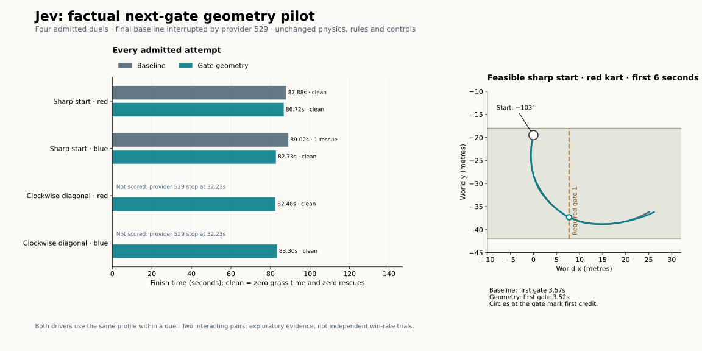

# 0079 — factual next-gate geometry

The gate-geometry candidate finished all four of its kart attempts cleanly.
Only one matched duel pair completed: the baseline finished one kart cleanly
and the other with a rescue, while geometry finished both cleanly. The second
baseline duel was interrupted by the provider's HTTP 529 overload response.
That pair is incomplete. This is encouraging exploratory evidence, with no
established improvement in gate recovery or general reliability. The optional
profile remains experimental; the default prompt is unchanged. Paid collection
is CLOSED, with no retries or replacement races.



A subsequent user-authorized [0080 attempt](0080-jev-overload-retry.md)
completed the missing baseline setup with two rescued finishes and no further
529, under substantially slower API response timing. The original 0079
outcomes below remain unchanged. The shared budget snapshot now includes 0080;
0079's boundary remains in this report and its results archive.

## Actual outcomes

| Fixed start / kart | Baseline | Added gate geometry |
| --- | --- | --- |
| Sharp misalignment / red | 87.88 s, clean | 86.72 s, clean |
| Sharp-start companion / blue | 89.02 s, one rescue | 82.73 s, clean |
| Clockwise diagonal / red | Interrupted at 32.23 s, 44 gates | 82.48 s, clean |
| Clockwise diagonal / blue | Interrupted at 32.23 s, 45 gates | 83.30 s, clean |

Clean means zero off-road time and zero rescues. The interrupted attempts are
infrastructure-censored, not driving failures, clean finishes or zero-second
results. Their partial distances are not compared against completed races.
The first complete pair had no contacts. The geometry diagonal had ten
contacts and one credited-progress lead change. The interrupted baseline had
three contacts and two lead changes before stopping. Neither contact nor a
lead change establishes passing intent.

The sharply misaligned red kart earned its first gate before rescue in both
arms: 3.5667 s baseline and 3.5167 s geometry. Both chose the same initial
`hard_left_accelerate` input. Its first application was three ticks earlier
with geometry (tick 24 versus 27); initial API times were 334.4 versus
396.0 ms. The 50 ms credit difference does not establish better understanding.
Red's total distance actually rose 2.33 m with geometry (990.83 versus
988.50 m). Blue traveled 3.11 m less and finished 6.28 s earlier with geometry,
with zero rescues versus one. One pair cannot separate a representation
benefit from ordinary model/control-timing variation.

The maximum first/adjacent credit gaps were 3.57/4.98 s for baseline red/blue
in the complete pair, and 3.52/2.27 s for their geometry counterparts. The
geometry diagonal gaps were 1.83/1.48 s. No saved-frame uncredited forward
plane-crossing episode arose in these attempts. No native query had a positive
still-required gate plane. Therefore **post-miss recovery was not tested**.
The improvement hypothesis remains open despite the clean geometry finishes.

Machine-readable [results](0079-gate-geometry-results.json) retain all eight
attempts, first-credit times, individual API timing, distances and censored
outcomes. [Actual native excerpts](0079-gate-geometry-native-excerpts.json)
retain all eight initial question pairs, raw native answers and application
metadata. They are captured model calls, not constructed examples.

## What changed

The unchanged wheel baseline supplied road preview plus gate `known` and
`signed_plane_m`. The explicit `include_gate_geometry=True` profile adds only
`wheel_facts.next_gate.geometry`: gate index, centre, both road-edge endpoints
and the gate's forward unit normal, expressed relative to the current kart.
Coordinate definitions state units and frame conventions. The entire pedal
question, wheel rules and action criteria remain identical. There is no
chosen crossing point, target line, predicted pose, eligibility rule,
steering instruction, host fallback or response repair.

For the sharp-start red kart, the actual added packet was:

```json
{
  "index": 1,
  "centre_ego_m": [8.4732, 9.896],
  "left_endpoint_ego_m": [-3.213, 7.1695],
  "right_endpoint_ego_m": [20.1594, 12.6224],
  "forward_normal_ego": [-0.227202, 0.973848]
}
```

Coordinates are metres, x forward along the kart's nose and y left. Endpoints
are the road edges; the existing one-metre body radius still determines
whether a crossing fits. The normal is dimensionless and points in the
required forward crossing direction. These are measurements, not proposed
actions. Both actual initial replies were:

```json
{
  "wheel": {"type": "choice", "choice": "hard_left"},
  "pedal": {"type": "choice", "choice": "accelerate"}
}
```

The excerpt above omits their saved probability/confidence fields for brevity;
the linked archive retains the complete native answers. The unchanged inverse
mapped both choices directly to the applied `hard_left_accelerate` input.

## Prospective design and physical feasibility

The [registration](0079-gate-geometry-registration.json) declared two fixed
starts, each run once under each profile in ABBA order. Both drivers received
the same profile within a duel. One start has a sharp, physically feasible
misalignment; the other repeats the clockwise diagonal grid associated with
the earlier long detour. Seeds and explicit positions matched between arms.
These are two interacting duel pairs, one incomplete, rather than eight
independent reliability trials. No changes were made between actual races.
The Python 60 Hz game retained 24 m width, one-metre bodies, 12 m/s speed,
0.12 rad steering, three laps, contact and the three-second rescue rule.

An untimed free screen retained four candidate misalignments. Its first listed
candidate, +10.5 m offset and −1.8 rad nose error, completed cleanly under a
200 ms scripted control; first red gate credit was 2.30 s. This establishes
one feasible control sequence, not model performance or an optimal route.
The sharper −2.0 rad candidate earned an initial gate but later needed rescue;
that result is preserved. Four full timed exact-interface controls separately
passed with all eight mock-driven karts clean.

The historical 0078 race 6 also provides a legal long unassisted continuation
between gate credits 111 and 112: 84.8667 to 129.1667 s, without rescue.
That establishes one possible continuation, not that a shorter one is
impossible. Extra travel alone cannot prove failure to find a feasible short
route. Preventing a miss and recovering after one remain separate endpoints.
This pilot did not inject an already-passed gate state; its initial placement
interface permits starts only before the first gate. A focused follow-up
should declare a just-past-gate start explicitly, prove a legal continuation
for it, and compare the frozen profiles from that same state. No new action
policy is needed. That follow-up is not implemented or admitted here.

## Verification, failure and cost

Before collection, 623 tests passed with three optional Rust skips; Ruff
passed. All 14,964 earlier questions/facts rebuilt unchanged under the default
profile. On every same snapshot the augmentation changed only the wheel gate
packet, preserving the entire pedal question. The maximum rounded-normal
projection discrepancy from the existing plane distance was 0.000149 m.
The Jev route remained `typesafe/jev-1.14-20261014` via TypeSafe, without
fallback. The complete fresh source/boot/server-bound clock gate passed four
full controls, 21 parent-pause samples and 170.1 s neutral time under the
existing timing limits. Exact-interface controls used both profiles.

A pre-race admission check initially rejected a changing catalog observation
timestamp. No race or model request had started and the ledger was unchanged.
The [recorded amendment](0079-metadata-admission-amendment.json) ignores only
that timestamp and preserves equality of every other route field. A free
check rejected changes to each of those 15 pinned fields. The original helper,
release and failure evidence remain preserved. Qualified source was unchanged.

All three completed duels passed full root-exit, exact native/factual/physics,
wire-byte, reservation and accounting audits before the next admission. The
fourth exited on the 529 overload response at red query 112, observation
31.9333 s. Its failed reply was not applied; a concurrent valid blue reply was
preserved as discarded after collection stopped. The separate forensic audit
reconstructed all partial physics, questions, raw bytes and ledger transitions,
without labeling that race complete. Across all four admissions, 17,480 saved
physics frames, 2,180 native requests and 4,360 budget transitions were checked;
2,179 replies were valid and one was the preserved provider error. The
[closure audit](0079-closure-audit.json) and [captured provider error](0079-provider-error.json)
retain the final verification and failed response. No prior
uncertainty was removed. No model request was retried.

The full uncertain reservation for that request is **$0.000688128 and 252,313
tokens**; actual billing is unknown. Total added charged spending was
$0.245447664 for 6,289,115 charged tokens and 2,180 requests. The closing
ledger is **$11.228800136002755 / $20**, **96,778 / 100,000 requests** and
**326,650,735 / 500,000,000 charged tokens**, with **71 uncertainties** and
no pending reservation. The [budget snapshot](model-budget-snapshot.json)
preserves this boundary. All paid windows are closed.
