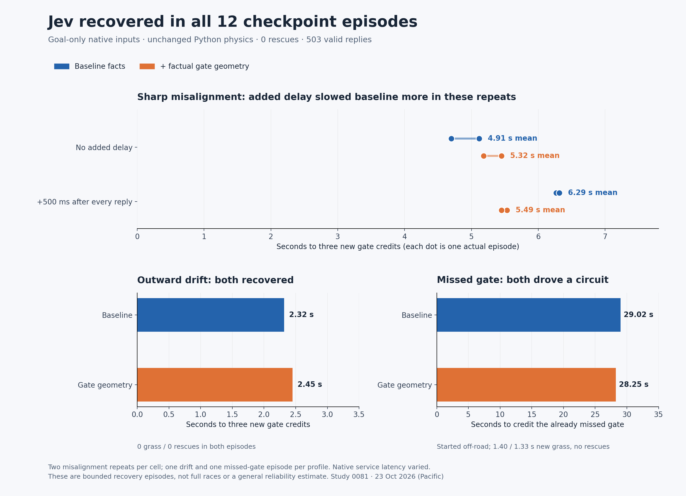
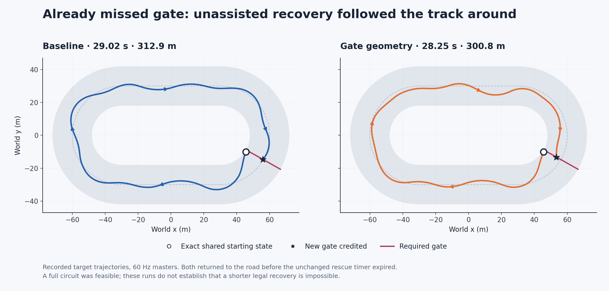

# 0081 — repeatable recovery and added-response-delay benchmark

Jev recovered **without rescue in all twelve registered episodes**, using
race goals, physical rules and measured facts without supplied driving rules.
Both the baseline and factual gate-geometry profiles passed every selected
state. This strengthens the evidence for unassisted recovery, but does not
establish a success-rate advantage for the extra geometry or general recovery
reliability. These were bounded checkpoint episodes, not twelve race finishes.
Collected 23 October 2026 (Pacific); the paid window is **CLOSED**.



## Actual results

Misalignment and outward drift required **three new gate credits before any
new rescue**. The already-missed gate required one new credit. All quantities
below start at the restored checkpoint; old race history is excluded.

| Episode | Starting state | Facts | Added wait per reply | Recovery endpoint | New grass | New rescues |
| ---: | --- | --- | ---: | ---: | ---: | ---: |
| 0 | Misaligned | Baseline | 0 | 3 gates / 5.12 s | 0 | 0 |
| 1 | Outward drift | Gate geometry | 0 | 3 gates / 2.45 s | 0 | 0 |
| 2 | Missed gate | Baseline | 0 | 1 gate / 29.02 s | 1.40 s | 0 |
| 3 | Misaligned | Gate geometry | 500 ms | 3 gates / 5.53 s | 0 | 0 |
| 4 | Misaligned | Gate geometry | 0 | 3 gates / 5.18 s | 0 | 0 |
| 5 | Outward drift | Baseline | 0 | 3 gates / 2.32 s | 0 | 0 |
| 6 | Missed gate | Gate geometry | 0 | 1 gate / 28.25 s | 1.33 s | 0 |
| 7 | Misaligned | Baseline | 500 ms | 3 gates / 6.27 s | 0 | 0 |
| 8 | Misaligned | Baseline | 500 ms | 3 gates / 6.32 s | 0 | 0 |
| 9 | Misaligned | Gate geometry | 0 | 3 gates / 5.45 s | 0 | 0 |
| 10 | Misaligned | Gate geometry | 500 ms | 3 gates / 5.45 s | 0 | 0 |
| 11 | Misaligned | Baseline | 0 | 3 gates / 4.70 s | 0 | 0 |

For misalignment, mean times were **4.91 s baseline / 5.32 s geometry** without
added wait, versus **6.29 / 5.49 s** with 500 ms added after every reply.
The delay penalty was descriptively 1.38 s for baseline and 0.18 s for geometry;
the delayed geometry episodes were about 0.80 s faster than delayed baseline.
There were only two repeats per cell, in the registered reversed-block order.
Native inference latency and the independently driven opponent still varied.
This is a promising latency-tolerance observation, not a reliable interaction
estimate or a reason to change the default profile yet.

Both drift episodes earned their **first** new gate after 0.117 s, before a
new model input could arrive at 0.317 s. That inherited momentum is why the
primary endpoint required three new gates. Holding the original input instead
caused rescue after 4.0 s and only one credit. Both actual drivers changed the
input and reached three gates with no grass or rescue.

The missed-gate case started with the kart already outside the body boundary
and 0.433 s of its three-second rescue allowance already spent. Baseline
returned fully to the road after 1.40 s; geometry after 1.33 s. Both then drove
around the stadium and crossed the still-required gate, travelling 312.9 m and
300.8 m respectively (track centreline length 308.5 m). Both first chose the
native `left_brake` input. This proves legal recovery in this state without
rescue; it does not prove that either driver recognized the miss strategically,
or that a shorter legal recovery is impossible. Neither episode is a clean
race finish: the initial off-road state and new grass remain recorded.



## What the benchmark holds fixed

The [prospective registration](0081-recovery-benchmark-registration.json)
contains the entire twelve-entry schedule, source/helper hashes, provider pin,
request bounds and stopping rules. The user accepted the recovery-benchmark
recommendation with “Let's do it”. No paid retry, replacement, tuning or extra
probe occurred. Jev remained pinned to `typesafe/jev-1.14-20261014` on TypeSafe
through OpenRouter's native Decisions API.

Every paid action came directly from the model's wheel and pedal choices.
Python dynamics, contact, gate credit, rescue timers, 24 m width, 12 m/s speed
ceiling, 0.12 rad wheel limit, native control menus and goal-only race questions
were fixed. The model was not told the host's short episode target. The only
prompt difference was the existing opt-in factual gate centre, endpoints and
forward normal in the wheel question; pedal text and facts stayed identical.
No steering strategy, suggested crossing point, host fallback or action repair
was supplied. The geometry default remains `False`.

The controlled delay was an explicit wait **after** a valid native response:

```python
record = await drivers[rid].decide(observation)
# In the registered delayed cells only:
await asyncio.sleep(added_delay_s)
# Submit this same response for this same observation through drive_duel.
```

Physics continued and the previous input stayed held during the wait. No
refreshed observation, second request or replacement action intervened. The
measured waits were median 500.73 ms, p95 501.30 ms, maximum 510.88 ms across
64 replies. This controls added waiting, not the complete end-to-end response
time. Across all 503 calls, API median was 217.76 ms, p95 280.56 ms, maximum
1,122.41 ms; five replies took at least one second. Across 481 applied replies,
observation-to-application age was median 250.29 ms, p95 766.97 ms, maximum
1,649.55 ms. The per-episode results retain target-specific distributions,
discarded replies and actual waits separately.

## Recorded state bank and feasibility

The [full state bank](0081-recovery-state-bank.json) restores both karts and the
world at full precision. It preserves velocity, steering, yaw, held input,
gate/lap progress, original world time, contact state, phase/rescue history and
timers. New capabilities and a new wall-clock pacing origin belong to each
episode; historical in-flight HTTP requests are not recreated. Static track
and handling must match the checkpoint. The runtime stops on the measured
endpoint without marking unfinished karts as full-race finishers.

| State | Original recording | Saved tick | Target | Why it matters |
| --- | --- | ---: | --- | --- |
| Misaligned | 0079 geometry study, race 0 | 0 | Red | Stationary, +10.5 m offset, −1.8 rad heading error |
| Outward drift | 0080 baseline retry | 175 | Blue | Recorded outward motion; held input leads to rescue |
| Missed gate | 0078 nearby-grid validation, race 6 | 5,133 | Red | Gate 32 already passed uncredited; body 0.458 m outside road |

The drift state was selected by **free feasibility screening**, not a random
sample of all failures. Later candidates (187, 199, 211, 223) and the initial
failed screen are retained. Tick 175 still had 8.88 m body clearance; it is an
early recoverable drift, not the most severe near-edge state. This selection
limits generalization.

All source prefixes were reconstructed from recorded inputs and each restored
state matched its original full-precision future for 120 frames. A free guide
proved a legal unassisted recovery in every selected state; unchanged held
inputs failed each primary endpoint. Free controls and guide inputs are
infrastructure/feasibility evidence, not Jev results or paid fallback policies.
The [prepared prompts](0081-recovery-prepared-prompts.json) are explicitly
constructed initial requests; the separate
[actual native excerpts](0081-recovery-native-excerpts.json) retain six paid
first requests/responses and their wire hashes. Both missed-gate profiles
actually returned:

```json
{"wheel": {"type": "choice", "choice": "left"},
 "pedal": {"type": "choice", "choice": "brake"}}
```

This excerpt omits response probability fields for readability; the archive
retains the complete answers and exact questions.

## Validation and accounting

Software checks passed **636 tests**, three optional Rust skips, and Ruff.
All 17,719 prior native question sets remained exact. The solo physics file
was byte-identical to the opening archive, and existing duel contact, stepping,
progress, observation, controls and summary methods retained identical ASTs.
Checkpoint round trips, future continuation, nonzero-clock pacing, real MCP
start/drive/stop, malformed snapshots, episode stopping and replay metadata
have direct coverage.

Eight unique exact-interface free recovery controls passed: 4,601 frames and
392 mock queries, with the real ledger unchanged. The first full clock check
was interrupted after one completed control; its collector disappeared without
an observable exit status. Its partial requests and bounded orphan recording
are preserved, and it was never counted as a pass. A fresh complete check then
passed four full duels/eight clean finishes, 21 physics frames during a 350 ms
parent pause, and 170.10 s of neutral clock. Root observed exit zero and verified
all 26 source hashes, evidence hashes, current boot and server PID/start ticks
before releasing the paid window. See the retained
[interruption note](0081-clock-interruption.json).

Root observed and fully reviewed each actual process before the next admission.
All **6,375 saved physics frames, 503 exact native queries and 1,006 shared-budget
transitions** passed reconstruction. Raw request/response UTF-8 and SHA256,
provider identity, unique response IDs across studies 0079–0081, direct action
application, reservation bounds and budget chains passed. Maximum derived
saved-frame lateness was 3.387 ms under the unchanged 100 ms limit. All replies
were HTTP 200, no new uncertainty occurred and pending reservations are empty.
One new kart contact occurred; it does not establish intentional racing tactics.

The study added **$0.055940682**, 503 requests and 1,380,310 charged tokens.
Closing cumulative totals are **$11.346796826002786 / $20**, **97,856 / 100,000
requests**, **329,563,859 / 500,000,000 tokens**. All 71 historical uncertainties,
including the original 529 reservation, are preserved. The
[current snapshot](model-budget-snapshot.json) and
[full outcome data](0081-recovery-benchmark-results.json) retain this boundary.
The remaining budget does not reopen this closed schedule.

All twelve actual episodes have standalone exports using the same spectator
UI, with 20 Hz visual samples and complete 60 Hz audit masters retained.
Chromium passed start/end captions and privacy checks on all twelve, 420 px
mobile layout without horizontal overflow, and an already loaded embedded
replay with networking disabled. Managed-browser file URL navigation was
blocked; that failed check is retained and was not bypassed. The complete
check used supported local HTTP loading before disabling network access.
The UI rebases checkpoint playback to zero and labels a recovery endpoint
instead of inheriting the other kart's historical win. Full source, raw calls,
controls, failed free screening, interrupted qualification, final proofs and
recordings remain under `artifacts/jev-recovery-bench-v1/`.

## Recommendation

Keep the goal-only baseline and gate geometry experimental. The immediate next
useful experiment is a **larger frozen bank of recoverable recorded states**,
including later drift and contact-induced errors, plus a declared delay ladder
(e.g. 0 / 250 / 500 / 1,000 ms). First prove physical feasibility at each state
and delay, then measure unassisted credits, grass, rescue and time with more
repeats. The current three states have a ceiling effect: every profile passed.
Do not increase difficulty or change prompts while collecting a comparison.
Only after that would it be useful to compare another factual prompt variant
or another model on the same bank. This recommendation opens no paid window.
