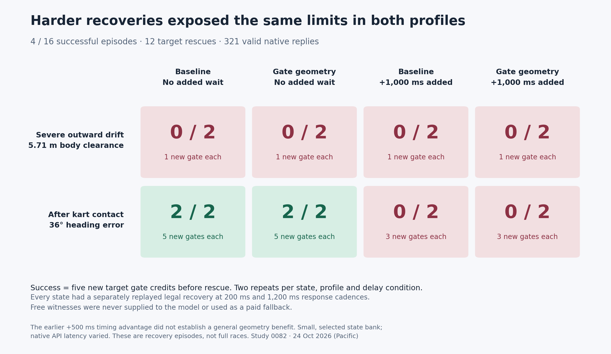

# 0082 — harder recorded recovery states and one-second response delay

**Gate geometry showed no recovery success-rate advantage.** Both profiles
recovered the post-contact state twice at normal latency, and neither recovered
it with one second added after every reply. Neither recovered the severe drift
at either delay. Across the sixteen registered episodes there were **four
unassisted successes and twelve target rescues**. All 321 native requests were
valid HTTP 200 replies; no attempt was provider-censored or replaced.
Collected 24 October 2026 (Pacific). The paid window is **CLOSED**.



## Results and interpretation

Success required **five new target gate credits before any new target rescue**,
within forty seconds. These are checkpoint episodes, not full race finishes.
All quantities below are changes from the saved state, excluding old history.

| State | Added wait after each reply | Baseline successes | Gate geometry successes | New credits in each attempt |
| --- | ---: | ---: | ---: | --- |
| Severe outward drift | 0 | 0/2 | 0/2 | 1 each, then rescue |
| Severe outward drift | 1,000 ms | 0/2 | 0/2 | 1 each, then rescue |
| Heading error after contact | 0 | 2/2 | 2/2 | 5 each, no new grass |
| Heading error after contact | 1,000 ms | 0/2 | 0/2 | 3 each, then rescue |

Successful post-contact recovery averaged **3.58 s baseline / 3.47 s geometry**.
The 0.12 s difference is small, based on two repeats per profile, and confounded
by variable native timing: one successful baseline first reply itself took
1.027 s. It does not establish a speed advantage. All four successes stayed
fully on-road. Each target failure accumulated three seconds off-road and
triggered the unchanged rescue. There were thirteen new rescues across both
karts (twelve target, one opponent) and zero new contacts.

The normal-latency drift failures matter independently of the imposed wait.
For episode 7, the target's maximum API latency was **209 ms**, its first input
arrived after 283 ms, and it still needed rescue. A long inference stall is not
necessary for this failure. The added second reduced post-contact recovery from
four successes across the two profiles to none; it did not change the already
failed drift outcome. With two selected states and two repeats per cell, this
is evidence about these conditions, not a general failure probability or a
precise latency threshold. The earlier 0081 half-second timing contrast does
not establish broad geometry robustness.

The frozen, reversed-block collection order and all endpoint times are retained:

| Episode | State | Profile | Extra wait | Outcome | New gates | Endpoint time |
| ---: | --- | --- | ---: | --- | ---: | ---: |
| 0 | Drift | Baseline | 0 | Rescue | 1 | 4.53 s |
| 1 | Post-contact | Geometry | 1 s | Rescue | 3 | 8.53 s |
| 2 | Drift | Geometry | 1 s | Rescue | 1 | 3.77 s |
| 3 | Post-contact | Baseline | 0 | Credited | 5 | 3.63 s |
| 4 | Post-contact | Geometry | 0 | Credited | 5 | 3.47 s |
| 5 | Drift | Baseline | 1 s | Rescue | 1 | 3.77 s |
| 6 | Post-contact | Baseline | 1 s | Rescue | 3 | 5.92 s |
| 7 | Drift | Geometry | 0 | Rescue | 1 | 4.07 s |
| 8 | Drift | Geometry | 0 | Rescue | 1 | 4.53 s |
| 9 | Post-contact | Baseline | 1 s | Rescue | 3 | 8.57 s |
| 10 | Drift | Baseline | 1 s | Rescue | 1 | 3.77 s |
| 11 | Post-contact | Geometry | 0 | Credited | 5 | 3.47 s |
| 12 | Post-contact | Baseline | 0 | Credited | 5 | 3.53 s |
| 13 | Drift | Geometry | 1 s | Rescue | 1 | 3.77 s |
| 14 | Post-contact | Geometry | 1 s | Rescue | 3 | 6.00 s |
| 15 | Drift | Baseline | 0 | Rescue | 1 | 4.28 s |

**Time to rescue is not a recovery time.** A longer failed episode is not a
successful or necessarily better recovery. Do not pool this cohort with 0081's
twelve successes: both the state bank and the measurement endpoint changed.

## Fairness, selected states and free feasibility

The [registration](0082-harder-recovery-registration.json) was frozen before
any new paid response. It admits two states × two profiles × two delay
conditions × two repeats: sixteen episodes, at most 6,400 new native requests.
The user accepted this experiment and explicitly authorized another 10,000
request slots. Geometry stays experimental and its default remains `False`.

The [state bank](0082-harder-recovery-state-bank.json) contains exact setup,
full-precision snapshots, source hashes, initial observations and reconstruction
proof counts:

- **Outward drift:** blue at tick 199 of the 0080 baseline retry. The body has
  5.714 m clearance, moving outward at 8.396 m/s with 44.40° heading error and
  12 m/s speed. This is later and closer to the boundary than 0081's tick-175
  case, which had 8.876 m clearance.
- **Post-contact:** red at tick 720 of 0078 validation race 9, one second after
  contact at tick 660 (closing speed 5.955 m/s). Heading error is 36.04°,
  clearance 8.659 m, outward speed 4.893 m/s. The error was observed after
  contact; the study does not isolate contact as its sole cause.

All original prefix frames matched the recordings; both restored states then
matched their original unrounded future for 120 frames. World time, velocity,
yaw, actual steering, held input, progress, contacts and rescue/phase history
were preserved. Static handling and geometry did not change.

The free three-credit post-contact screen could succeed simply by holding the
old input, then need rescue later. We therefore selected five new credits as
the endpoint before collecting paid outcomes. Held-input controls failed both
five-credit targets. In every delayed actual episode the first new gate was
credited before any new target input arrived; the five-credit endpoint avoids
mistaking inherited motion for model recovery.

Each selected state has an independently replayed **legal native-input witness
at both 200 ms and 1,200 ms response cadences**. The normal drift witness earned
five credits in 32.42 s with 2.75 s new grass and no rescue. A bounded offline
beam search found a delayed drift witness in 25.70 s with 2.63 s grass and no
rescue. The post-contact witnesses took 3.30 / 3.37 s, both on-road. These are
free physical feasibility controls, not Jev results, optimal driving policies,
or instructions supplied to the model. Paid collection imports no witness or
search and never falls back to one.

The [free proof archive](0082-harder-recovery-free-feasibility.json) includes
all four retained control sequences and replay results. Candidate feature
screens, unsuccessful simple-guide and early-input searches, and beam logs
remain under `artifacts/jev-recovery-delay-v2/`. Selection used free feasibility,
not random sampling or paid outcomes. A witness shows that recovery is possible;
it does not show that the model has sufficient information to infer it.

## What changed and what stayed fixed

The only application-source change was the authorized admission bound in
`duel_run.existing_budget`, from 100,000 to 110,000 requests. Every physics,
prompt, observation and control-source byte matched the prior study. All 503
0081 native question sets were reproduced exactly; the earlier 17,719-question
proof was reused with unchanged prompt modules.

Every paid steering and pedal input was Jev's direct native choice. The model
stayed pinned to `typesafe/jev-1.14-20261014` on TypeSafe via OpenRouter Decisions.
Python physics remained 60 Hz, 24 m road, 12 m/s maximum speed, 0.12 rad maximum
wheel, 1 m kart radius, the same contact/gate/phase mechanics, and the same
three-second rescue. Goal-only race instructions and native menus stayed fixed;
the host's five-credit endpoint was not supplied as a model objective.

The only prompt treatment was the existing factual gate centre, endpoints and
forward normal in the wheel question. Pedal facts/questions stayed identical.
The delay treatment waited one second after a valid response, while physics
continued under the old input, then submitted that exact reply for its original
observation. No refresh, extra POST, smoothing, action repair or supplied driving
rule intervened. Both active drivers used the same assigned profile and delay.

The injected wait was not stated in the model question. This tests the frozen
driver under an unannounced timing change; it does not establish the limits of
a driver explicitly informed about its control delay. Actual response age also
varied with service timing. Across all calls API median/p95/max were
**201.97 / 340.18 / 1,542.18 ms**, with six replies at least one second.
Across 290 applied replies, observation-to-application age was median
**249.35 ms**, p95 **1,284.18 ms**, maximum **2,583.91 ms**. All 73 measured
added waits were at least one second (median 1,000.79 ms, maximum 1,010.55 ms).
Per-episode target distributions and discarded replies remain in the
[full results](0082-harder-recovery-results.json).

The [actual native excerpts](0082-harder-recovery-native-excerpts.json) retain
all eight first-block target question sets, facts, answers and wire hashes.
Every first target reply in the drift cells selected:

```json
{"wheel": {"type": "choice", "choice": "hard_left"},
 "pedal": {"type": "choice", "choice": "brake"}}
```

The first-block delayed post-contact replies selected `hard_left_accelerate`, which
was also the held input at the checkpoint. A shared first input does not explain
an entire trajectory; the full subsequent native replies and application ticks
are retained. The [prepared question archive](0082-harder-recovery-prepared-prompts.json)
is separately labeled constructed, not an actual response archive.

## Qualification, accounting and delivery

**637 tests passed**, three optional Rust skips; Ruff and diff checks passed.
On this rebuilt environment, a fresh complete clock gate passed four full
free duels/eight clean finishes, 21 physics samples during the 350 ms parent
pause, and 170.10 s neutral clock. Root observed exit zero and verified all
26 source hashes, boot, server PID/start ticks and evidence hashes.

All eight unique exact-interface free controls passed their strict timing,
physics, native-question and accounting audits: **2,030 frames / 162 mock
queries**, with the real ledger unchanged. Their simple guide had six rescued
and two credited task outcomes. Those outcomes are retained and are not model
results or infrastructure failures; the separately replayed witnesses establish
physical feasibility. The declared interface qualification did not require the
simple guide to solve every state.

Root admitted one actual process at a time, observed its exit, and fully audited
it before the next. All **4,552 saved physics frames, 321 exact native queries
and 642 shared-budget transitions** passed. Exact UTF-8 request/response hashes,
pinned routes, native action application, cross-study unique response IDs,
reservation bounds and budget chains passed. Maximum derived saved-frame
lateness was 3.558 ms. All replies were valid HTTP 200, pending is empty and
all 71 historical uncertainties remain unchanged.

The [ceiling-only amendment](0082-request-ceiling-amendment.json) raised the
shared request cap to **110,000**, preserving every existing charge. Dollar
and token caps remain **$20 / 500 million**. This study added **$0.035799498**,
**321 requests**, **883,230 charged tokens**. Closing totals:
**$11.382596324002778**, **98,177 / 110,000 requests**,
**330,447,089 / 500,000,000 tokens**, 71 uncertainties, no pending reservations.
See the [budget snapshot](model-budget-snapshot.json). Remaining budget does not
reopen this closed sixteen-entry schedule.

All sixteen actual episodes have standalone replay exports using the same
spectator UI, with 20 Hz visuals and 60 Hz audit masters preserved. The UI
shows recovery credit or rescue, rebases the episode clock to zero, and hides
terminal outcomes until the endpoint. Raw calls, failures, source archives,
state screens, witnesses and per-episode reviews remain under
`artifacts/jev-recovery-delay-v2/`.

## Next prompt hypothesis

Keep the baseline/default unchanged. A useful next factual ablation would give
the wheel decision the kart's own current motion and control-timing information.
The wheel question currently receives road/gate/body/opponent/race facts but no
own speed, velocity, actual steering, yaw rate or held input. The pedal head
has kart and road-frame motion fields. The frozen questions also omit the
known added wait. Making physical state and scheduled control timing visible
would add observations and mechanics without supplying a steering/braking
strategy.

Test own-motion fields and timing visibility separately on this same frozen
bank before combining them. This is a hypothesis, not an explanation proven
by the current experiment. Earlier solo wheel-motion benefits
[did not repeat](0074-goal-only-wheel-motion-repeats.md), which is a reason to
use paired failure cases and retain all outcomes. This recommendation makes
no new source change and opens no paid window.
