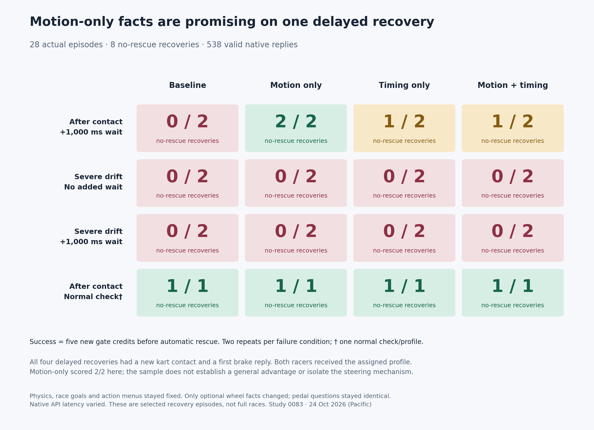

# 0083 — factual wheel motion and control-timing visibility

**Motion-only facts are a promising candidate for one delayed recovery.** On
post-contact recovery with a one-second added wait, motion-only scored **2/2
without automatic rescue**, baseline **0/2**, timing-only **1/2**, and the combined
profile **1/2**. Every profile failed severe drift at both delays (0/16 overall).
All four normal post-contact checks succeeded, one per profile. All 28 episodes
completed with valid native replies and full audits; no attempts were replaced.
Collected 24 October 2026 (Pacific). The paid window is **CLOSED**.



These are five-new-gate recovery episodes, not full race finishes. A successful
episode excludes automatic rescue; normal physical kart contact remains enabled.
All four delayed successes included a new contact and began with a native brake
reply. The small sample supports further testing, not a general benefit or an
isolated steering mechanism. Defaults remain unchanged.

## Frozen comparison and results

The [prospective registration](0083-wheel-observability-registration.json)
specified four profiles: baseline, motion-only, timing-only, and both. Gate
geometry was disabled throughout. The exact two-state
[0082 bank](0083-wheel-observability-state-bank.json), its five-credit endpoint,
40 s deadline, 200-decision/racer ceiling, source seeds and both karts' full
saved state were reused without modification.

Three previously failing strata received two repeats per profile (24 episodes),
with reverse order in the second block. Four additional normal post-contact
checks received one episode per profile. The 28-entry schedule's worst bound
was 11,200 new requests; at the opening balance, even the worst final admission
retained 1,023 slots above the unchanged 1,000-request floor. No cap was raised.

| Recovery condition | Baseline | Motion only | Timing only | Both |
| --- | ---: | ---: | ---: | ---: |
| Post-contact, +1 s wait | 0/2 | **2/2** | 1/2 | 1/2 |
| Severe drift, no added wait | 0/2 | 0/2 | 0/2 | 0/2 |
| Severe drift, +1 s wait | 0/2 | 0/2 | 0/2 | 0/2 |
| Normal post-contact check | 1/1 | 1/1 | 1/1 | 1/1 |

The two motion-only delayed successes took **5.68 / 4.92 s** and added zero
grass. Timing-only succeeded in 4.85 s, then required rescue on its repeat;
both required rescue first, then succeeded in 4.93 s. Baseline needed rescue
on both attempts after three new credits. Every severe-drift episode earned
one new credit, then required rescue. Every target failure added three seconds
of grass under the unchanged rescue rule.

Normal post-contact check times were baseline 3.53 s, motion 3.67 s, timing
4.17 s, both 4.03 s. There was only one check per profile, so these do not
establish relative speed or general regression safety. Across all 28 episodes
there were eight no-rescue successes, twenty target rescues (twenty-one across
both karts), and seven new contacts. The
[full results](0083-wheel-observability-results.json) retain all outcomes,
per-episode deltas, reply ages, contact details and initial native choices.

## Factual changes, without driving rules

Only optional **wheel-question measurements and timing descriptions** changed.
The complete pedal question, race objective, physical control descriptions,
criteria and native inverse mapping stayed identical. Both active Jev drivers
received the assigned profile; this is a comparison of joint two-kart profiles.

Motion-only adds the already validated speed/steering/yaw/held-input packet and
copies the existing pedal road-lateral-velocity measurement into the wheel
question. The actual first post-contact motion packet included these values
(units are omitted here for readability and retained in the archive):

```json
{
  "motion": {
    "speed_m_s": 11.9262,
    "steering_angle_rad": 0.09811,
    "yaw_rate_rad_s": 0.48593,
    "held_input": "hard_left_accelerate"
  },
  "current_road_frame": {"velocity_left_m_s": -4.8933}
}
```

Timing-only adds the host's **known scheduled wait**, including explicit zero
in normal conditions, and the fixed simulation frequency:

```json
{
  "control_timing": {
    "post_response_wait_s": 1.0,
    "physics_hz": 60
  }
}
```

Its units state that native request/response time is additional and variable,
that the current response time is unknown, and that physics and held input
continue during both intervals. It does not supply an inference-time estimate,
a future pose, a predicted crossing point, a suggested input, steering/braking
thresholds or an action policy. The combined profile is the union of those two
packets. Pedal receives neither new packet, which isolates wheel observability
but leaves timing information absent from that head.

The programmatic options are opt-in:

```python
# Construct measurements; never select or alter an action.
facts = duel_facts(raw, config, racer_id,
                   include_wheel_motion=True, control_timing_s=1.0)
# Collector flags expose the actual scheduled added_delay_s to the wheel head.
# include_wheel_motion=True, include_control_timing=True
```

All new flags default off. The implementation reuses existing measured motion
projections; no physics, runtime, UI, track, handling or rescue source changed.
The 24 m road, 12 m/s ceiling, 0.12 rad wheel maximum, 1 m body radius, three-lap
goal and five-credit host measurement stayed fixed. Jev stayed pinned to
`typesafe/jev-1.14-20261014` on TypeSafe through OpenRouter Decisions. Every paid
input was its native wheel/pedal choice, with no host filtering, repair,
rescue policy, fallback steering or use of the free feasibility witnesses.

## What the successful trajectories establish

The [actual native excerpts](0083-wheel-observability-native-excerpts.json)
contain the first target request and response from all 28 episodes. For the
two delayed motion-only successes, the first replies were `hard_left_brake`;
the following replies were respectively `right_accelerate` and
`hard_right_accelerate`. Both baseline delayed attempts began with
`hard_left_accelerate` and later required rescue. These are observed replies,
not supplied instructions or recommended controls.

The [contact and first-choice review](0083-wheel-observability-contact-review.json)
found that all four delayed successes (two motion, one timing, one both) began
with brake and had one new contact. All four delayed failures began with
accelerate and had no new contact. The new contacts in the successful delayed
runs occurred after 2.68, 3.72, 3.75 and 3.13 s, with closing speeds between
0.42 and 1.50 m/s. Contact can slow or deflect either kart.

Every actual initial pedal question was byte-identical within each state,
across all profiles and delays. The returned pedal choice nevertheless varied;
identical question text does not guarantee identical native answers. The full
request's wheel packet changed, service timing varied, both racers' subsequent
behavior changed, and the sample is small. The result does not isolate whether
the gain came from steering choices, initial braking, contact effects, native
variation or their interaction. No intentional collision strategy is established.

The first motion success also had a 1.038 s native reply and an applied reply
age up to 2.082 s. The baseline failures' target API maxima were about 249 and
242 ms. Its success is therefore not explained simply by receiving uniformly
faster replies. Conversely, the comparison does not equalize native latency or
prove tolerance across arbitrary delays. Current timing-only and combined
1/2 outcomes give no demonstrated additional benefit over motion-only.

## Preservation, qualification and accounting

**740 tests passed**, three optional Rust skips; Ruff and diff checks passed.
The added tests cover measured facts, wheel-only isolation, unchanged rules
and menus, explicit zero wait, malformed timing/motion rejection before any
reservation, and all fifteen native action combinations under all four
profiles and both existing geometry settings.

All **18,543 prior native question sets from 57 paid collections** were
reproduced byte for byte with the new flags off, including historical gate
geometry profiles. Only `duel_decisions.py` and `duel_bench.py` changed; all
physics, runtime, controls and UI source bytes remained identical. The exact
0082 state files and all four legal 200/1,200 ms physical witnesses were
independently replayed again. No new state was selected using paid outcomes.
The [prepared prompts](0083-wheel-observability-prepared-prompts.json) are
separately labeled constructed initial questions, never model responses.

All sixteen exact-interface free combinations passed their native, physics,
timing and budget audits: **4,061 frames / 323 mock queries**, zero real model
calls. The simple guide had twelve rescued and four credited task outcomes;
those are retained as free control results. Fifty-six applied one-second waits
each spanned at least 59 physics samples. A fresh complete current-source
clock qualification passed four full free duels/eight clean finishes, 21 samples
during the 350 ms parent pause, and 170.10 s of neutral clock. Root observed
exit zero and verified source, boot, server PID/start ticks and evidence hashes.
No tests, builds or heavy analysis ran during timed collection.

Root admitted one actual episode process at a time, observed exit, and fully
reviewed it before the next. All **7,902 physics frames, 538 exact native queries
and 1,076 shared-budget transitions** passed reconstruction. Exact raw UTF-8
hashes, route identities, unique response IDs across studies 0079–0083,
reservation bounds and direct action application passed. Maximum derived
saved-frame lateness was 4.389 ms. All replies were valid HTTP 200; no new
uncertainty or pending reservation occurred. No retry, replacement or tuning
occurred during the comparison.

Across all calls, API median/p95/max were **208.52 / 291.06 / 1,542.52 ms**;
five replies took at least one second. Across 482 applied replies,
observation-to-application age was median 249.98 ms, p95 1,300.30 ms, maximum
2,081.98 ms. The 133 recorded added waits were median 1,000.80 ms, p95
1,007.31 ms, maximum 1,013.48 ms. Per-target distributions remain in the results.

The study added **$0.061232598**, **538 requests**, **1,509,702 charged tokens**.
Closing totals are **$11.443828922002771 / $20**, **98,715 / 110,000 requests**,
**331,956,791 / 500,000,000 tokens**, all **71 historical uncertainties** retained,
pending empty. The [snapshot](model-budget-snapshot.json) records that boundary.
Remaining budget does not reopen this closed 28-entry schedule.

All 28 actual episodes have standalone replays using the same spectator UI,
with 20 Hz visual exports and complete 60 Hz audit masters retained. Raw calls,
state inputs, frozen source, controls, clock evidence and per-episode reviews
remain under `artifacts/jev-wheel-observability-v1/`.

## Recommendation

Keep motion-only as an experimental candidate and keep all defaults unchanged.
The next useful validation is more matched baseline/motion-only repetitions
and a few prospectively selected post-contact holdouts, retaining contact and
initial pedal-choice evidence. Earlier solo motion benefits
[did not repeat](0074-goal-only-wheel-motion-repeats.md); two successes in one
selected state are insufficient to promote this packet. Stacking timing with
motion has not shown an additional benefit here. Severe drift remains a
separate unsolved condition. This recommendation opens no further paid window.
