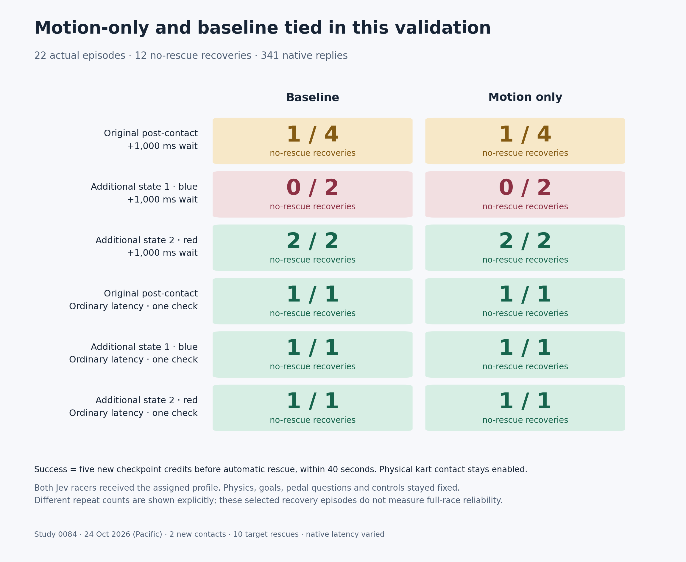

# 0084 — motion-only recovery validation

**Motion-only did not outperform baseline in this follow-up.** Each profile
recovered **3/8 delayed episodes** and **3/3 ordinary-latency checks**. On the
original post-contact state, both scored **1/4** with an extra second of waiting.
The earlier study's motion-only 2/2 versus baseline 0/2 advantage did not repeat.
Keep motion facts experimental and default off.

All **22 registered episodes** completed on 24 October 2026 (Pacific), with
341 valid native replies, complete audits and no replacements. The paid window
is **CLOSED**. These are selected five-checkpoint recovery episodes, not full
races or a general reliability estimate.



## Results

Success means five new target checkpoint credits before any new automatic
target rescue, within 40 seconds. Ordinary physical kart contact stays enabled.

| Starting state and added wait | Baseline | Motion only |
| --- | ---: | ---: |
| Original post-contact, +1 second | **1/4** | **1/4** |
| Additional state 1: blue kart, +1 second | **0/2** | **0/2** |
| Additional state 2: red kart, +1 second | **2/2** | **2/2** |
| Original post-contact, ordinary latency | 1/1 | 1/1 |
| Additional state 1, ordinary latency | 1/1 | 1/1 |
| Additional state 2, ordinary latency | 1/1 | 1/1 |

The original delayed successes took **4.87 seconds baseline / 4.92 seconds
motion-only**. Both added zero grass and had one new contact. The six original
delayed failures earned three credits and required rescue after 5.92–8.75 seconds.

Additional state 1 failed all four delayed attempts after 5.47–5.52 seconds,
with three new credits and no new contact. Additional state 2 succeeded all four
delayed attempts, without grass or new contact: baseline **5.58 / 6.80 seconds**,
motion **5.77 / 5.83 seconds**. Two repeats do not establish a speed advantage.

Ordinary-latency times, baseline/motion respectively, were **3.80 / 3.85 seconds**
for the original, **3.55 / 3.28 seconds** for state 1, and **4.05 / 4.22 seconds**
for state 2. Each is a single check, all on-road and without new contact. Overall:
12 target successes, 10 target rescues, 14 new rescues across both racers and
two new contacts. [Full outcomes](0084-motion-validation-results.json) retain
every endpoint, reply age, discarded reply and both racers' deltas.

## What was held fixed

The [prospective registration](0084-motion-validation-registration.json) specified
eight delayed original-state episodes, eight delayed additional-state episodes
and six ordinary-latency checks. Each original delayed profile had four repeats;
each additional delayed profile had two. Profile order was counterbalanced.
The 200-decision/racer ceiling bounded the study at 8,800 native calls, within
the existing request cap and admission floors. Actual use was 341 calls.

Both active Jev racers received the assigned profile and actual 0/1-second
post-response wait. Native inference time was additional and variable. The
current observation and held input continued through inference and waiting;
the original native reply was applied unchanged. No observation refresh,
retry, host fallback, action filtering or supplied driving rule was used.

Only an existing optional factual packet differed:

```python
include_wheel_motion=True     # False in baseline
include_control_timing=False
include_gate_geometry=False
```

Motion-only supplies the wheel question with current measured speed, actual
front-wheel angle, yaw rate, held input and road-relative lateral velocity,
with descriptive units. Baseline road, gate, body and competition facts remain.
The full pedal question, goal-only race rules, criteria, action menus and native
inverse mapping are identical. Explicit timing facts are absent in both arms.

There were **no application source changes**: all 26 frozen files, including
Python physics, runtime, question construction, controls and UI, are byte-identical
to study 0083. The 24 m road, 12 m/s speed ceiling, 0.12 rad wheel maximum, 1 m
body radius, contacts and three-second rescue rule stayed fixed. Models still
see the full three-lap goal; the five-credit host endpoint is not supplied as
their objective. Jev remained pinned to `typesafe/jev-1.14-20261014`, TypeSafe,
through native OpenRouter Decisions.

## State selection and physical feasibility

The original checkpoint was copied byte for byte from study 0083. Two additional
recorded states were selected before free qualification or new paid outcomes
using the [frozen descriptive rule](0084-motion-validation-selection.json):
60 ticks after a contact with at least 2.5 m/s closing speed, at least 20 degrees
absolute heading error, at least 3 m body clearance and at least 8 m/s speed.
Exclude the original recording; select the first eligible state in each of the
first two distinct recordings in numeric race order.

| Case | Recorded source | Tick / target | Heading error | Minimum body clearance |
| --- | --- | --- | ---: | ---: |
| Original | 0078 validation race 9 | 720 / red | +36.04° | 8.66 m |
| Additional state 1 | 0078 validation race 1 | 140 / blue | −29.76° | 10.06 m |
| Additional state 2 | 0078 validation race 4 | 2146 / red | +23.35° | 9.71 m |

The [state bank](0084-motion-validation-state-bank.json) retains both karts'
full-precision checkpoints, controls, progress, contact/phase/rescue state and
world clock. Original prefix evidence was reused; each additional source prefix
was reproduced exactly and passed 120 full-precision future-frame comparisons.

All three states have independently replayed legal-input recoveries with
200 ms and 1,200 ms input intervals. The harder blue-kart delayed witness took
**29.22 seconds**, added **2.80 seconds of grass**, and required the independently
controlled opponent to brake. It establishes existence of legal joint inputs;
it does not establish a successful delayed-observation policy or recovery
against every opponent. All initial failed guides, the failed 241-trial
guide/short-sequence screen, unsuccessful bounded searches and stopped redundant
free searches are retained. An unused contingency candidate is labeled unused;
the original two selected states were kept. No witness or search entered any
paid prompt or collector policy.

These are prospectively selected recorded-state holdouts. Their source
trajectories were historical model runs; they are not wholly unseen driving.

## First choices and contacts

The [actual native excerpts](0084-motion-validation-native-excerpts.json) contain
the first target request and response from every episode. The
[contact review](0084-motion-validation-contact-review.json) verifies that
initial pedal questions were byte-identical within each state across profiles,
delays and repeats. Initial wheel questions were identical within state/profile.

On the original delayed state, every first wheel answer was `hard_left`:

| Profile | First pedal brake | First pedal accelerate |
| --- | --- | --- |
| Baseline | 1 success, with contact | 3 failures, no new contact |
| Motion only | 1 success, with contact | 3 failures, no new contact |

For example, actual successful episodes 18 (baseline) and 19 (motion-only)
both returned:

```json
{
  "wheel": {"type": "choice", "choice": "hard_left"},
  "pedal": {"type": "choice", "choice": "brake"}
}
```

The host applied `hard_left_brake` directly. Their later contacts occurred after
4.03 / 2.88 seconds, with closing speeds 0.45 / 0.48 m/s. The other six original
delayed attempts first returned `hard_left_accelerate` and required rescue.
This is observed behavior, not a supplied rule or an isolated causal mechanism.
Identical pedal question text does not guarantee identical native answers;
the full request differs, both racers receive treatment, and native timing varies.

The contact/brake association is specific to this starting state. All four
delayed successes in additional state 2 began with **accelerate** and had
**no new contact**. The results do not support a universal braking rule or an
intentional collision strategy.

## Verification, timing and budget

The unchanged source allows reuse of the completed 0083 test/preservation
evidence: 740 passing tests, three optional Rust skips, 18,543 prior question
sets reproduced exactly and the preceding 538 actual query audits. These were
not claimed as new test runs. New prepared questions verified wheel-only
augmentation and unchanged pedal/rules/criteria; they are explicitly labeled
[constructed prompts](0084-motion-validation-prepared-prompts.json).

The complete 0083 clock qualification was **revalidated and reused**, not rerun:
four complete free controls/eight clean finishes, 21 samples during a parent
pause and 170.10 seconds of neutral clock. Current source, boot, server PID/start
ticks, all saved evidence hashes and the original root-observed exit were checked.

All twelve new exact state/profile/delay free interfaces passed: **3,109 frames /
233 mock queries**, zero model calls, unchanged real ledger. Their task outcomes
were eight credited and four rescued; these are scripted controls, not Jev
results. All 44 applied one-second waits spanned at least 59 physics samples.

Root launched one actual episode process per admission, observed its exit and
completed native, physics, wire, route, reservation and accounting review before
the next. All **7,351 physics frames, 341 exact native queries and 682 shared
budget transitions** passed. Every reply was valid HTTP 200; response IDs were
unique across studies 0079–0084, usage stayed within full reservations, and
all actions matched raw native choices. Maximum saved-frame lateness was
**4.65 ms**. No tests, builds or heavy analysis ran during timed collection.

Across all 341 replies, including discarded replies, API median/p95/max were
**212.12 / 341.86 / 1,545.88 ms**; five replies exceeded one second. Across 298
applied replies, observation-to-application age was median **309.06 ms**, p95
**1,321.03 ms**, maximum **2,183.97 ms**. The 168 recorded added waits were
median **1,000.76 ms**, p95 **1,002.26 ms**, maximum **1,013.54 ms**. A motion-only
original-state failure had a target API maximum of only 231 ms, so provider
stalls do not explain all failures in the added-wait condition.

Added cost: **$0.038079048**, **341 requests**, **939,428 charged tokens**.
Closing totals: **$11.481907970002775 / $20**, **99,056 / 110,000 requests**,
**332,896,219 / 500,000,000 tokens**. All 71 historical uncertainties remain;
pending is empty. The [budget snapshot](model-budget-snapshot.json) records
this boundary. All 22 registered entries are closed; unused budget does not
reopen the study.

All actual episodes have standalone spectator replays. Complete raw calls,
60 Hz masters, frozen source, free failures/witnesses and per-episode audits
remain under `artifacts/jev-motion-validation-v1/`.
All 22 exports passed Chromium start/end captions, privacy and 420 px mobile
layout checks, with zero browser exceptions. A loaded embedded replay also
worked with networking disabled. The temporary browser was closed after QA.

## Implication

The added facts have not earned promotion. Both profiles handled the three
ordinary-latency checks, but their delayed recovery success was strongly
state-dependent and identical in this small comparison. The original-state
brake/contact association remains worth understanding, with no demonstrated
need for the motion packet. Future work should distinguish repeatable control
under stale observations from adding more measurements. This report authorizes
no further paid work.
