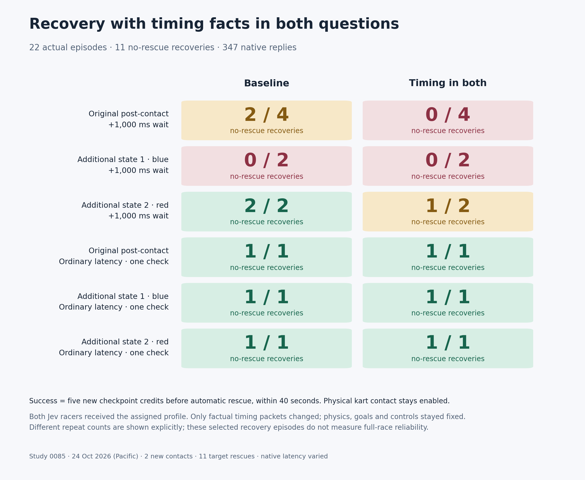

# 0085 — factual control timing in both decision questions

**Giving both questions the known control delay did not improve recovery.**
Baseline recovered **4/8 delayed episodes**, versus **1/8 with timing facts in
both questions**. Both profiles passed **3/3 ordinary-latency checks**. Keep the
new option experimental and default off. This small, selected comparison shows
no benefit; it does not establish that timing information generally causes harm.

All **22 registered actual episodes** completed on 24 October 2026 (Pacific),
with 347 valid native replies, complete audits and no replacements. The paid
window is **CLOSED**. These are five-checkpoint recovery episodes, not full races.



## Results

Success means five new target checkpoint credits before any new automatic target
rescue, within 40 seconds. Ordinary physical kart contact remains enabled.

| State and timing | Baseline | Timing in both questions |
| --- | ---: | ---: |
| Original post-contact, +1 second | **2/4** | **0/4** |
| Additional blue-kart state, +1 second | **0/2** | **0/2** |
| Additional red-kart state, +1 second | **2/2** | **1/2** |
| Original state, ordinary latency | 1/1 | 1/1 |
| Blue state, ordinary latency | 1/1 | 1/1 |
| Red state, ordinary latency | 1/1 | 1/1 |

The two original-state delayed baseline recoveries took **4.92 / 4.97 seconds**,
added no grass and each included one new contact. The other six original delayed
attempts earned three credits, then required rescue after **5.92–8.58 seconds**.
All four delayed blue-state attempts required rescue after **5.45–5.48 seconds**,
with three new credits and no new contact.

On the delayed red state, baseline succeeded in **5.58 / 5.62 seconds**. The
timing profile required rescue at **5.75 seconds**, then succeeded in **5.60 seconds**.
No new contact occurred in that state. Its failed timing attempt first returned
`left_accelerate`; the successful repeat returned `hard_left_accelerate`. Identical
initial questions can produce different native choices. One outcome difference
in two repeats is insufficient for a general regression claim.

All ordinary-latency checks stayed on-road and had no new contact. Baseline /
timing times were **3.80 / 3.48 seconds** on the original state, **3.10 / 3.13 seconds**
on blue, and **4.18 / 4.10 seconds** on red. These are single checks per cell,
not evidence of a general speed advantage or regression safety.

Overall: **11 target successes, 11 target rescues, 15 new rescues across both
racers, two new contacts**. [Full outcomes](0085-both-head-timing-results.json)
retain both racers' deltas, endpoint times, discarded replies, response ages
and contact details. No failed attempt was replaced or excluded.

## Hypothesis and factual intervention

Earlier experiments supplied timing facts only in the steering question. The
pedal question had not received that packet. Because first brake-versus-accelerate
choices were associated with recovery on the original state, this study tested
whether supplying the same delay facts to both questions improved driving.

The treatment adds the existing `control_timing` packet to both `wheel_facts`
and `pedal_facts`. Its actual values in delayed episodes were:

```json
{
  "post_response_wait_s": 1.0,
  "physics_hz": 60,
  "units": "post_response_wait_s: fixed seconds between receiving a native reply and submitting it. Native request/response time is additional and variable; the current response time is unknown. physics_hz: simulation steps per second. Physics and the held input continue during both intervals."
}
```

Ordinary-latency treatment explicitly supplies **0.0** seconds. That describes
only the scheduled post-response wait; it does not claim zero inference time
or zero total action delay. Baseline omits the packet in both conditions.

Both active Jev racers receive the assigned profile and actual wait. Physics
and the old input continue through native inference and the additional wait;
the original reply is then submitted unchanged. The packet supplies no braking
instruction, steering threshold, predicted pose, expected inference duration,
recommended action or winning policy. Motion and gate-geometry additions were
disabled throughout.

The new programmatic option is opt-in:

```python
# Collector treatment; added_delay_s is 0.0 or 1.0 in the frozen schedule.
include_control_timing=True
include_pedal_timing=True
include_wheel_motion=False
include_gate_geometry=False

# Direct factual construction:
facts = duel_facts(raw, config, racer_id,
                   control_timing_s=1.0, include_pedal_timing=True)
```

`include_pedal_timing` defaults to `False` and requires explicit known timing.
Existing wheel-only timing behavior and all old defaults remain exact. The
only application changes were factual construction plus driver/collector/audit
plumbing in `duel_decisions.py` and `duel_bench.py`. Goal rules, criteria, all
15 direct native inputs, decoding, physical timing behavior, Python physics,
track, contacts, rescue, runtime and UI stayed unchanged. No host action filter,
fallback, silent repair, refreshed observation or free witness entered paid driving.

An [independent review of all 347 actual question sets](0085-both-head-timing-native-fact-review.json)
removed only the timing packets and reproduced baseline facts and serialized
questions exactly. Both copies matched the actual scheduled wait. Initial
questions were byte-identical within each state/profile/wait combination.

## First choices and contacts

The [actual native excerpts](0085-both-head-timing-native-excerpts.json) include
the first target request and response from every episode. On the original
delayed state:

| Profile | First native brake | First native accelerate |
| --- | --- | --- |
| Baseline | 2 successes, both with contact | 2 failures, no new contact |
| Timing in both | 0 attempts | 4 failures, no new contact |

Every first wheel choice there was `hard_left`. Successful baseline episodes
17 and 18 actually returned:

```json
{
  "wheel": {"type": "choice", "choice": "hard_left"},
  "pedal": {"type": "choice", "choice": "brake"}
}
```

All four delayed timing attempts instead first returned `hard_left_accelerate`.
Thus, exposing the delay in the pedal question did not produce more initial
braking or successful recovery in this sample. This is observed behavior, not
an instruction supplied to Jev or a proven mechanism. Both racers receive the
profile, native timing varies, and braking/contact effects are not isolated.
Successful delayed red-state attempts began with accelerate and had no new
contact, so these observations do not support a universal braking rule.

## Frozen comparison and physical feasibility

The [prospective registration](0085-both-head-timing-registration.json) reused
the exact 0084 schedule and [state bank](0085-both-head-timing-state-bank.json):
eight delayed original-state episodes, eight delayed additional-state episodes,
and six ordinary checks, with counterbalanced profile order. The original
delayed state had four repeats/profile; each delayed holdout had two; ordinary
checks had one per state/profile. Both racers used the same pinned Jev route:
`typesafe/jev-1.14-20261014`, TypeSafe, native OpenRouter Decisions.

No new state was selected. All three state files were copied byte for byte;
**3,009 source-prefix frames and 360 full-precision continuation frames** were
rechecked. All six legal-input physical witnesses were independently replayed
at 200 ms and 1,200 ms input intervals. The difficult blue delayed witness
requires a braking opponent and **29.22 seconds / 2.80 seconds of grass**;
it proves existence of legal joint inputs, not a delayed-feedback controller
or recovery against every opponent. Earlier failed screens remain preserved
under the 0084 artifact root.

The 24 m road, 12 m/s speed cap, 0.12 rad wheel limit, 1 m kart radius and
three-second rescue rule stayed fixed. Jev still sees the full three-lap,
120-gate objective; the five-new-credit host endpoint is not supplied as its
goal. These recorded-state holdouts were selected prospectively in 0084, but
their source trajectories were historical model runs. The cohort does not
measure full-race or general-track reliability.

## Verification and timing

**810 tests passed**, three optional Rust skips; Ruff and diff checks passed.
Tests cover all 15 native action combinations under historical and new profiles,
both gate-geometry settings, shared-budget concurrency, unchanged rules/menus,
explicit zero wait, independent copies of the packet and malformed/missing
timing rejection before any request or reservation.

All **19,422 prior native question sets from 107 paid collections** reproduced
byte for byte, including historical motion and wheel-only timing profiles.
Only the two declared application files changed; all physics, runtime and UI
source bytes stayed identical. [Prepared prompts](0085-both-head-timing-prepared-prompts.json)
are labeled constructed examples, separately from actual model responses.

A **fresh complete clock qualification** passed on the new current-source server:
four full free controls/eight clean finishes, 21 physics samples during the
350 ms parent pause, and **170.10 seconds** of neutral clock. Root observed the
collector's zero exit and verified all 26 source hashes, current boot, server
PID/start ticks and all saved evidence hashes. This clock run was not reused
from a previous study. No builds, tests or heavy analysis ran during timed collection.

All twelve new exact state/profile/wait free interfaces passed: **3,108 frames /
234 mock queries**, zero real calls and unchanged real ledger. Eight credited
and four rescued outcomes belong to the scripted guide, not Jev. All 44 applied
one-second waits spanned at least 59 physics samples.

Root launched one actual process per admission, observed its exit and completed
full review before the next. All **7,198 physics frames, 347 raw native queries
and 694 shared-budget transitions** passed physics, facts, native inverse,
exact UTF-8 wire hashes, route identity, response-ID uniqueness across studies
0079–0085, usage/reservation bounds and accounting checks. Every reply was valid
HTTP 200; no retry, replacement, new uncertainty or pending reservation occurred.
Maximum derived saved-frame lateness was **3.91 ms**.

Across all replies, including discarded replies, API median/p95/max were
**217.30 / 270.89 / 572.43 ms**; none took one second. Across 303 applied replies,
observation-to-application age was median **284.11 ms**, p95 **1,317.22 ms**, maximum
**1,598.94 ms**. The 168 recorded added waits were median **1,000.73 ms**, p95
**1,003.14 ms**, maximum **1,013.63 ms**. The weak delayed result therefore
occurred without large provider stalls, under the explicitly imposed wait.
Native latency still varied, and this tests a known scheduled delay rather than
arbitrary real-world network delays.

## Accounting and review artifacts

The study added **$0.038608794**, **347 requests**, **952,610 charged tokens**.
Closing totals: **$11.520516764002778 / $20**, **99,403 / 110,000 requests**,
**333,848,829 / 500,000,000 tokens**. All 71 historical uncertainties remain,
pending is empty, and all caps are unchanged. The
[budget snapshot](model-budget-snapshot.json) records that boundary. All 22
registered entries are closed; remaining budget authorizes no new calls.

Every actual episode has a standalone spectator replay. Complete 60 Hz masters,
raw calls, frozen source, free controls, clock evidence and per-episode audits
remain under `artifacts/jev-both-head-timing-v1/`.
All 22 exports passed Chromium start/end, privacy and 420 px mobile layout
checks, with zero browser exceptions. A loaded embedded replay also worked
with networking disabled. The temporary browser was closed after QA.

## Implication

The timing packet has not earned promotion. Sharing factual delay information
with both questions did not resolve delayed recovery and did not induce the
initial braking associated with the original-state successes. The lower observed
score supports keeping it experimental; small counts and joint treatment limit
causal conclusions. Further work should diagnose the control/observation bottleneck
before stacking additional facts. No further paid experiment is opened here.
