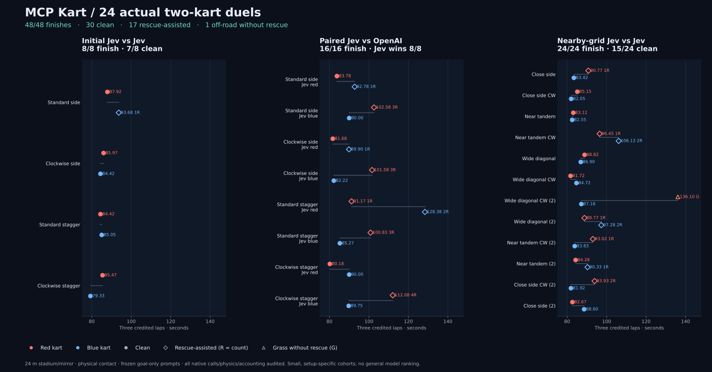
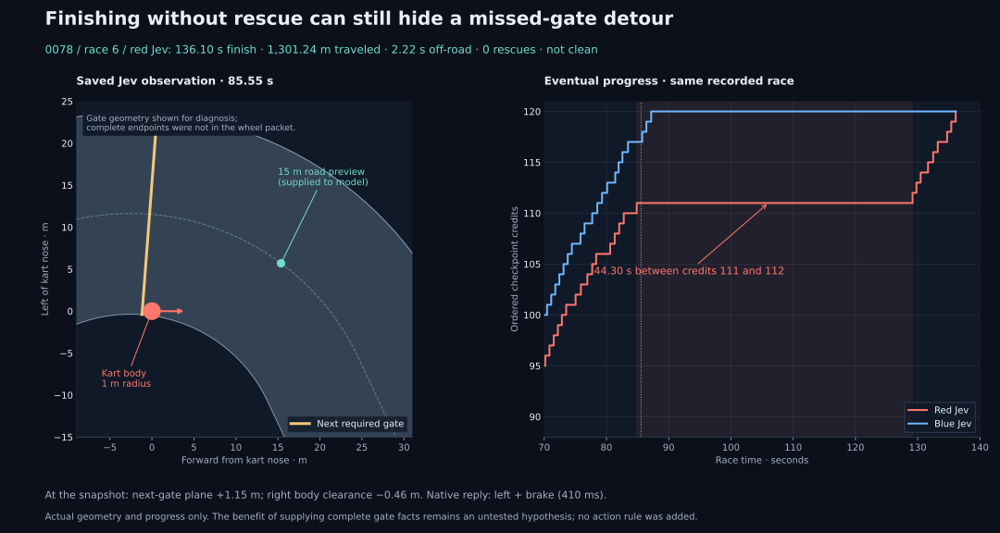

# Two-kart progress checkpoint — 22 October 2026

We now have a small competitive kart experience: two independent models share
one continuously running Python track, make direct physical control choices,
contact one another and produce a winner plus inspectable replays. It works
with Jev versus Jev and with Jev versus OpenAI. Reliable recovery and deliberate
racing strategy remain unproven.

## Results from this session



| Frozen cohort | Kart finishes | Clean finishes | Physical interaction |
|---|---:|---:|---|
| [0076: four Jev/Jev duels](0076-two-kart-jev-jev.md) | 8 / 8 | 7 / 8 | 10 contacts, 7 lead changes |
| [0077: eight paired Jev/OpenAI duels](0077-two-kart-jev-openai.md) | 16 / 16 | Jev 7 / 8; OpenAI 1 / 8 | 13 contacts, 12 lead changes |
| [0078: twelve nearby-grid Jev/Jev duels](0078-two-kart-nearby-grids.md) | 24 / 24 | 15 / 24 | 29 contacts, 17 lead changes |

All 48 kart attempts finished. Thirty were clean, seventeen used rescue, and
one went off-road without rescue. Jev was clean in 29/40 attempts across all
cohorts; OpenAI in 1/8. These pooled fractions describe these particular
attempts, not a common-distribution reliability estimate: starts and opponents
differ, karts within a race interact, and there are few repeats.

Jev won all eight paired model comparisons, with each model occupying both
assignments on each grid. This favors Jev for the frozen setup developed around
it, not as a general ranking. Both models used native OpenRouter Decisions
routes with pinned identities. No game, prompt, harness or response-frequency
adjustment was made based on their relative performance.

## What this proves for the project

| Desired experience | Current evidence | Practical limit |
|---|---|---|
| A model drives through MCP in real time | Direct native controls; continuous isolated 60 Hz Python clock; all 24 duels timing-valid | Long API replies still occur; sustained-delay robustness is unresolved |
| The model chooses how to drive | Goal-only mechanics and question-local measurements; no supplied steering/braking predicates or host fallback | The factual representation, menus and forgiving track are engineered support |
| Opponents share a physical game | Two independent inference loops; swept circular-body contact; common gates and finish order | Two karts and one stadium family only |
| Racing can be watched and inspected | Live spectator, replay scrubber, contact/rescue/lead markers, model latency, compact standalone HTML and video | Cloud localhost still needs forwarding for a remote live browser |
| Comparisons retain their failures | All planned attempts retained, exact questions/raw replies/control ticks/physics/budget replay | Small cohorts and unequal API latency limit causal interpretation |
| A competition can run to completion | 48/48 finishes, including close clean Jev/Jev races | Assistance and detours remain common enough to matter |

The fairest description is a **working competitive prototype on a forgiving
track**. A close clean race is demonstrable. A driver that reliably recovers,
understands a missed gate, passes intentionally or adapts to varied circuits
has not yet been demonstrated.

## Fairness boundary

The game retains the 24 m stadium, 12 m/s ceiling, .12 rad maximum wheel angle,
fifteen direct inputs and three-second off-road rescue. Multiplayer adds a
1 m body radius, full-footprint road/gate tests and equal-mass contact. Rescues
give no progress; finished and temporarily respawned karts are non-colliding.
The [mechanics and interface](../two-kart-driver.md) state the exact rules.

Both questions receive current opponent position and relative velocity in the
driver's nose frame, physical body clearances and race progress. The model
receives the competitive objective and control meanings. It does not receive
a passing rule, preferred lane, collision-avoidance threshold, suggested action,
racing line or recovery policy. The host applies exactly the returned wheel
and pedal combination. Inputs remain held during inference; the other kart and
physics keep running. There is no retry, output repair or hidden driver.

These distinctions preserve the user's preference for objectives, fair mechanics
and useful facts without telling the model which action wins. They do not make
the representation neutral: it was developed around Jev, and all current live
evidence depends on this particular support package.

## Examples from actual model calls

The [native excerpts](0076-0078-two-kart-native-excerpts.json) retain six exact
request payloads, native response bodies, identities, latency and application
records. They are captured examples, not illustrative invented responses.
Their selectors cover a close contact race, OpenAI's clean and assisted runs,
Jev's long missed-gate detour, and long replies in clean and assisted attempts.

For example, at 18.9167 s in 0076 race 2, blue Jev received these measured
fields (a subset of the exact captured wheel question):

```json
{
  "road": {"preview_15m_bearing_deg": 33.808},
  "next_gate": {"known": true, "signed_plane_m": -0.0024},
  "opponent": {
    "ego_x_m": 1.2623,
    "ego_y_m": -2.2838,
    "surface_gap_m": 0.6094,
    "relative_forward_velocity_m_s": 2.6218,
    "relative_left_velocity_m_s": 2.1974
  }
}
```

The rules defined positive bearing as left and the wheel settings as absolute
angles, but did not prescribe a bearing-to-action rule. Its captured response
contained `wheel.choice="left"` and `pedal.choice="accelerate"`; the native
input applied was `left_accelerate`. API time was 205.0 ms. The full request,
response probabilities and identifying source path are in `contact_race` in
the native archive. This shows direct model control near an opponent, without
establishing why the model chose it.

| Actual excerpt | Observation time | API time | Applied input | Eventual attempt outcome |
|---|---:|---:|---|---|
| OpenAI missed gate, 0077 race 4 blue | 37.02 s | 282.7 ms | `hard_left_accelerate` | Finished with two rescues and extra travel |
| Jev missed gate, 0078 race 6 red | 85.55 s | 410.1 ms | `left_brake` | Finished at 136.10 s, off-road without rescue |
| Jev long reply, 0078 race 9 blue | 41.50 s | 2,404.3 ms | `right_accelerate` | Finished with one rescue |
| Jev long reply, 0078 race 11 blue | 33.12 s | 3,215.0 ms | `left_accelerate` | Clean finish |

The last two rows are examples of different eventual outcomes, not a causal
comparison or evidence that the chosen action caused the later rescue.

The prompt builder is [duel_decisions.py](../../src/mcpkart/duel_decisions.py).
`duel_facts` adds measured opponent/race information;
`DuelDecisionClient.questions` supplies the same goal-only rules to the two heads;
the native inverse maps five wheel choices times three pedal choices to the
existing fifteen actions. The exact current questions and raw request/response
hashes were checked for all 14,964 calls after collection.

Neither contact nor a credited-progress lead change alone proves intention.
Models' choice responses contain no reasoning trace that would establish
passing plans. Recovery traces also show why completion and competence differ:
one Jev attempt traveled 1,301 m, with a 44.30 s gap between adjacent gates,
despite needing no rescue. An OpenAI attempt traveled 1,372 m. Three ordinary
centerline laps are about 925 m.

A long detour is not proof that a short legal recovery was available from that
pose. Ordered forward gate crossings and the forward-only controls constrain
recovery. Any experiment expecting a quick unassisted return must first
establish its physical feasibility; preventing a gate miss and recovering
after one are different endpoints.



## Follow-up after this checkpoint

[0079](0079-factual-next-gate-geometry.md) subsequently tested the gate-facts
candidate below. Geometry finished four attempts cleanly; only one matched
pair completed because the other baseline duel stopped on provider HTTP 529.
First-gate performance was nearly identical and no post-miss recovery arose.
The original 24-duel findings above remain separate; recovery benefit remains
unproven. The current budget snapshot includes that later study and its
additional uncertain reservation. All paid windows are closed.

## Next evidence worth collecting (original recommendation)

The next focused candidate is complete **factual next-gate geometry** in the
kart's frame, compared against the unchanged baseline on predefined missed-gate
and recovery states. The current wheel head has road preview plus limited gate
facts, so a road-following recovery can still miss required progress. Supplying
gate endpoints/relative pose would describe the world without prescribing a
steering action. This is a hypothesis, not a tested improvement or a change
already made to the game.

First establish free physical feasibility under the existing gate and control
rules. Where a further circuit is the feasible legal recovery, extra travel
alone should not be scored as failure to find a shorter route. Then freeze a
small matched paid ablation that separates preventing a miss from recovery,
using first unassisted gate credit, clean finish, extra travel and gate gap as
endpoints. Keep latency and model comparisons separate until a causal
delay intervention can distinguish stale observations from representation
limits. New bends, more racers, durable race orchestration, authentication,
matchmaking and public deployment remain later product work.

Separately, paired changes to opponent position or velocity with identical own-
kart/road facts could test whether choices respond to the opponent. A changed
choice would establish input sensitivity, not useful strategy; live frozen
tests would still be needed to establish better avoidance or passing.

## Verification and cost

All 138,401 saved actual physics frames, 14,964 native calls and 29,928 shared
budget transitions passed full reconstruction. No endpoint error or new
uncertainty occurred. Original collection source and all failure evidence are
preserved. Post-collection changes improve credential redaction, worker cleanup,
memory reporting, CLI operation and spectator/replay presentation; the physics
and prompt builders remain unchanged. Final software and free clock evidence
are [recorded separately](0076-0078-two-kart-delivery-checks.md) from the collected
model results. The final free gate passed four full controls, 21 physics frames
during the parent pause, and a 600.0167 s neutral run with 36,002 exact frames.

This goal cost $1.8341. Cumulative charged spending is $10.9834 under the $20
ceiling, with 94,598/100,000 requests and 320,361,620/500,000,000 charged tokens.
All 70 historical uncertain requests remain recorded; no reservation is pending.
The [budget snapshot](model-budget-snapshot.json) preserves the current boundary.
All paid windows are closed, and no more paid calls will be made this session.
