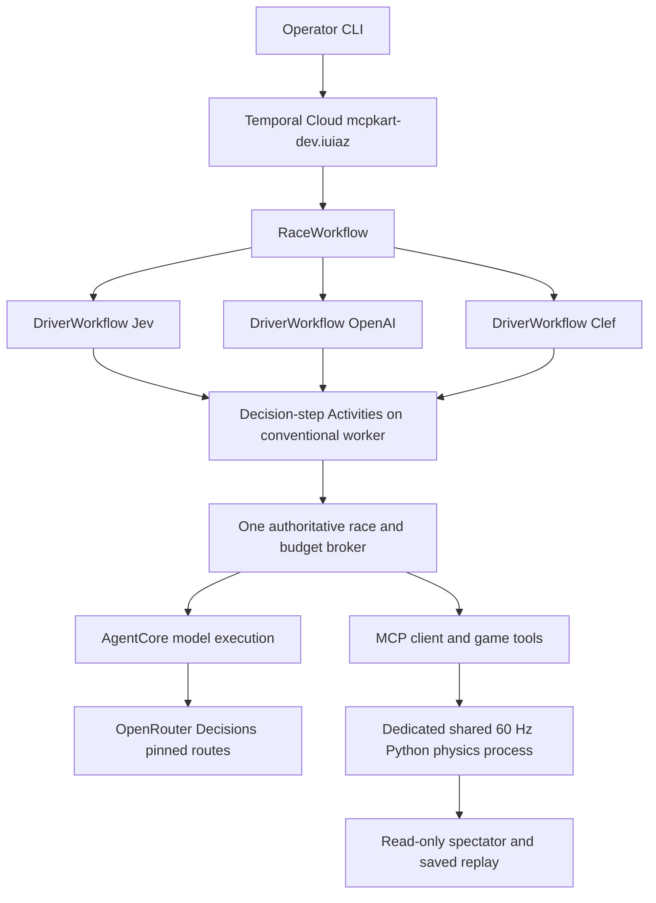

# Three model racing demo with Temporal and AWS AgentCore

Finalized implementation plan for 29 October 2026. Branch:
`codex/aws-temporal-demo`. Target Temporal Cloud namespace: `mcpkart-dev.iuiaz`
(user reports us-west-2). AWS target: the user's company sandbox, with
us-west-2 proposed for colocation. Another demo uses that sandbox; all new
resources have a dedicated prefix. Implementation is proceeding on this branch.
The [free preparation checkpoint](../experiments/0086-aws-demo-preparation.md)
records completed software, local/cloud mock rehearsals and the remaining gates.

The demo is one operator-started, three-lap race between Jev, OpenAI Decisions,
and Clef on the current stadium oval. The user confirmed ghost karts,
conventional Temporal workers, and a preference to retain MCP where useful.
Keep the spectator and replay, use Temporal to coordinate independent drivers,
and use AgentCore Runtime to execute model work. All three models use the existing OpenRouter Decisions transport;
Bedrock inference is out of scope. Public play, accounts, matchmaking, and multiplayer
hosting are outside scope. The audience discovers the winner of this run; one
race cannot establish a general model ranking.

## Agreed scope for tonight

Use three **ghost karts** sharing one 60 Hz physics clock. Existing solo handling,
ordered gates, rescue rules, native wheel/pedal choices, and real-time inference
delays remain the basis. Each kart holds its previous input while its model
responds. Faster drivers never wait for slower drivers. Ghost mode removes
collision luck and avoids implementing a new three-body swept-contact solver.
Ghost mode is implemented on this branch with an explicit trio schema.

Use identical goal-only prompt construction for all three models, extended to
describe two opponents. Leave the experimental geometry, motion, and timing
additions off. Do not add a host driving policy to improve the show. Start all
karts on the same physics tick after infrastructure readiness checks.

The live screen should show the oval, model names and colors, lap/gate progress,
rescues, elapsed time, last decision latency, and an explicit live/replay label.
Keep a separate Temporal UI tab showing the parent race and three driver
workflows. Export the actual race for offline playback if venue networking fails.

## What exists and what must change

The starting point was the current Python implementation, not the old tile game
under `legacy/`. The old Temporal workflow advances a different game at one-second
ticks; restoring that stack would change the challenge.

| Area | Starting implementation | Demo work |
| --- | --- | --- |
| Physics | `src/mcpkart/duel.py`: exactly red and blue, two grid positions, one pairwise swept contact solver | Add an explicit three-racer ghost mode or sibling world; preserve existing duel defaults and contact behavior |
| Observations | `duel.py` and `duel_decisions.py`: one `competition.opponent`, strict two-racer identity validation | Two opponents per racer in stable ID order; update objective and validation consistently |
| Runtime and MCP | `duel_runtime.py`, `duel_process.py`, `duel_worker.py`, `duel_web.py`: racer capabilities, commands, finish state | Three identities, private capabilities, sequence validation, independent command admission, all-racer finish handling |
| Drivers and CLI | `duel_run.py`: two model arguments; Jev/OpenAI CLI choices; `duel_clock.py` mocks assume two providers | Add Clef, three model slots, correct Cloudflare/Prime Intellect mock metadata, bounded independent loops |
| Budget and audit | `duel_decisions.py`: one shared journal; `duel_bench.py` audit asserts fewer than two reservations before reserve | One authoritative writer, at most one reservation per racer and three globally, complete raw/native/frame reconstruction |
| Presentation | `static/duel.html` and replay export contain red/blue assumptions | Three cards, colors, metrics, replay seeking and finish/tie labels derived from racer metadata |
| Orchestration | No Temporal dependency in current `pyproject.toml` | Isolated demo dependency group, workflows, worker, race start command, cancellation/finalization |
| AgentCore | No deployment in the current implementation | Dedicated runtime package, invocation permissions, secret access, deployment configuration and cleanup runbook |

Avoid changing the global `RACERS` tuple to three and hoping the existing solver
generalizes. It unpacks exactly two karts, tracks a single touching state, and
returns paths for one pair. The three-kart ghost path needs an explicit schema
version and replay/audit support. Existing two-kart tests and saved recordings
must remain usable. A solid-contact trio is a separate physics project.

## Conventional Temporal workers and AgentCore Runtime

Run an ordinary, operator-managed Python Temporal worker connected to
`mcpkart-dev.iuiaz`. It polls its dedicated task queue continuously during the
demo. Do not use Temporal's serverless-worker integration, preview access,
Worker Controller setup or automatic AgentCore worker provisioning. AgentCore
Runtime remains the compute for the model adapter, invoked explicitly by our
application. Copy the Temporal service address from the namespace connection
settings rather than inferring it from the namespace ID.

Keep the Temporal worker and authoritative budget broker on a dedicated Linux
host. A small AgentCore handler accepts the frozen Decisions request, makes one
provider POST, and returns the exact provider response bytes and metadata in an
envelope. It does not select controls or run game physics. One reusable Runtime
deployment can serve three isolated racer sessions; three deployments are not
required. Use stable session IDs and finish mock initialization before the race
clock starts.

AgentCore supports custom agents and external model providers, so these models
do not need to move to Bedrock inference. Its HTTP contract uses port 8080,
`POST /invocations`, and `GET /ping`; container deployments require ARM64.
Use IAM-signed server-side invocations. The browser connects only to the
spectator and never receives AWS credentials or driver capabilities.
[Runtime capabilities](https://docs.aws.amazon.com/bedrock-agentcore/latest/devguide/agents-tools-runtime.html),
[HTTP contract](https://docs.aws.amazon.com/bedrock-agentcore/latest/devguide/runtime-http-protocol-contract.html).

Direct Python code deployment can package code and Linux ARM64 dependencies in
a ZIP, avoiding a Docker build. Package only the adapter, not the repo's many
gigabytes of artifacts. Start with an available Python version satisfying the
project's >=3.12 requirement, pin it, and verify binary wheels in the target
region. Configure outbound access to OpenRouter.
Use Secrets Manager for runtime credentials and a dedicated execution role.
[Python code deployment](https://docs.aws.amazon.com/bedrock-agentcore/latest/devguide/runtime-get-started-code-deploy-python.html).

## Workflow and state boundaries

Activities call the adapter through `InvokeAgentRuntime`; the broker authorizes
each provider dispatch and stores its evidence. A conventional worker and the
broker can share the same Linux host, while physics stays in a separate process.
The broker/physics service must be reachable from its callers. A cloud worker
cannot reach this Mac's localhost; the demo uses an isolated Docker Linux host with a loopback spectator port and
local MCP. A remote deployment would need an authenticated endpoint or private network. The model handler in the ordinary integration needs
only the provided question packet, not direct access to the physics service.

`RaceWorkflow` owns readiness, a stable logical race ID, three concurrent child
workflows, a bounded deadline, and finalization. Each `DriverWorkflow` repeatedly
executes one decision-step Activity for its own racer and never synchronizes
decision rounds with other racers. The broker performs observe/reserve,
dispatch authorization, evidence settlement, and native control application.
Use a stable `(race_id, racer_id, decision_seq)` operation identity and persist
results before acknowledging them. Return compact receipts to Temporal; keep
raw requests/replies, frames, secrets, and capabilities outside workflow history.

Do not schedule physics ticks as Temporal timers or Activities. At 60 Hz, a
240-second race produces 14,400 physics frames before considering decisions.
Temporal records Activity scheduling and results in history; use child histories
and bounded operation counts, and implement Continue-As-New only if actual
history size requires it. All nondeterministic HTTP, filesystem and model work
belongs in Activities. Physics remains in its existing isolated process.
[Activity history](https://docs.temporal.io/workflow-activity),
[Continue-As-New](https://docs.temporal.io/develop/python/continue-as-new).

Measure observe-to-apply time separately from provider time. Per-decision
Temporal scheduling and AgentCore invocation add overhead whose effect is not
known until rehearsal. Evaluate Local Activities as described below. If the
remaining overhead prevents acceptable driving, a finite
long-running driver Activity can retain the fast loop, with heartbeats and
external receipts. That alternative provides durable lifecycle orchestration,
not a Temporal event for each model decision; name this distinction on stage.
Never compensate by slowing the simulation or secretly coaching one model.

### MCP is the preferred game interface

The current collector creates a `fastmcp.Client` and calls `start_duel`,
`drive_duel`, `observe_duel` and `finish_duel` through MCP. `bench.tool` calls
`client.call_tool`; `duel_web.py` registers the tool handlers and forwards to the
process runtime. This is real MCP traffic, not just an MCP-shaped function name.

The models themselves receive two typed choice questions. They return wheel
and pedal labels, which Python maps to one native action. Python then invokes
the MCP driving tool. No model currently discovers tools or generates an MCP
request, and adding an agent framework is unnecessary to preserve this behavior.

Retain MCP for the trio: it gives the model drivers a standard interface to the
independent game service and permits future external drivers. Preserve per-kart
capabilities, observation ticks, monotonically increasing command sequences,
rescue invalidation and actual application acknowledgments. Those semantics are
implemented by the game, not guaranteed by MCP itself. Use a persistent client
session rather than reconnecting for every input.

A direct application API could carry exactly the same commands if measurements
justify it, but that is a fallback, not the selected interface. Bedrock's lack
of hosted remote-MCP tools does not prevent our Python driver from being an MCP
client. If the Bedrock alternative emits a function call, application code would
still execute it through MCP. Do not add an extra model round trip just to make
the transport choice look more agentic.

### Local Activities for the driving loop

Python provides `workflow.execute_local_activity`. It runs the Activity on the
same worker process as its workflow, without dispatching a separate Activity
task through Temporal. Its completion is recorded with the workflow task.
This can remove scheduling overhead, while the AgentCore invocation, provider
request and MCP command retain their own network costs. It cannot route work
to AgentCore or a different worker by itself.
[Python Local Activity API](https://python.temporal.io/temporalio.workflow._activities.html#execute_local_activity).

Use a Local Activity only around a short, idempotent broker operation such as
`step(race_id, racer_id, decision_seq)`. The broker persists dispatch state,
provider reply and the MCP acknowledgment under that stable identity. Repeating
the operation returns the saved receipt; it does not pay for another decision
or apply another control. An outstanding operation must be attached to or
reported as unresolved, never dispatched again automatically. Unknown provider
outcomes still stop the paid run and retain the reservation.

Local results are durable only after their marker reaches Temporal. A worker
failure before that point can rerun a Local Activity, even with
`maximum_attempts=1`; disabling Activity retries does not disable workflow-task
replay. Local Activities have no individual Activity heartbeats and can delay
signals. Configure explicit bounded timeouts, bounded batches with durable
checkpoints, and an independent game deadline. Keep deterministic formatting and
validation as ordinary workflow code rather than needless Activities.
[Local Activity execution and durability](https://docs.temporal.io/local-activity).

Benchmark regular and Local Activity paths with identical mock provider delays
and AgentCore/MCP transport. Measure complete observation-to-application p50,
p95 and maximum, decision throughput, clock lateness and cancellation response.
Exercise a worker failure after broker completion but before the Temporal marker;
verify no repeated provider dispatch, charge or control application. Select Local
Activities for paid driving only after that test passes. Regular Activities
remain the baseline, and startup/finalization can use ordinary Activities even
when driving uses Local Activities. Do not promise a fixed millisecond saving
before measuring this deployment.

### Recovery and paid side effects

Temporal retries Activities by default. Explicitly set `maximum_attempts=1` on
paid dispatch, disable HTTP/AWS SDK retries on the corresponding path, and
disable provider fallback. Retrying read-only or genuinely idempotent setup and
finalization is separate. If a provider might have received a POST but no result
was durably recorded, keep the full reservation uncertain and stop the paid run.
A request ID or heartbeat alone cannot make an external model call exactly once.
[Temporal retries and idempotency](https://docs.temporal.io/develop/python/failure-detection).

Keep one budget broker and one durable ledger, outside replaceable AgentCore
sessions. Distributed drivers must not each open a copy of `budget.json` or each
start an independent `BudgetJournal`. The current journal assumes synchronous
transitions in one writer. Extend its interface rather than merely sharing a
filename between cloud containers. Store raw native replies and provider identity
before applying controls; validate the race, racer and sequence at application.

Workflow recovery does not recover an external physics process. A lost broker,
unknown outstanding model dispatch, or lost physics host ends this attempt with
retained evidence; do not promise seamless paid race recovery. Demonstrate worker
restart/resumption only in mocks until cross-service recovery is verified. Cancel
children and finalize the race on failure, with server-side deadline enforcement
as the backstop if orchestration or cleanup is unavailable.

## Model readiness and comparison

The three requested models remain documented on OpenRouter's Decisions surface:

| Racer | Model ID | Proposed pinned provider |
| --- | --- | --- |
| Jev | `typesafe/jev-1.14` | `typesafe` |
| OpenAI Decisions | `openai/gpt-6-luna-decisions` | `openai` |
| Clef | `cloudflare/clef` | `primeintellect`, matching the current code default |

These are existing typed Decisions routes, not chat-completion agents.
[Jev](https://openrouter.ai/typesafe/jev-1.14),
[OpenAI Decisions](https://openrouter.ai/openai/gpt-6-luna-decisions),
[Clef](https://openrouter.ai/cloudflare/clef).

Read live catalog/endpoints metadata before freezing the run. Current model
pages are documentation, not proof that this sandbox's key can obtain responses.
Historical Clef studies used other routes; record the chosen provider explicitly.
The last Clef rerun stopped on a five-second timeout after two valid responses,
as recorded in [0069](../experiments/0069-clef-topup-rerun.md). Clef's page also
warns of text-state truncation on the Workers AI route. Check the exact chosen
provider's handling of both question heads and the expanded opponent facts;
do not assume a listed context window guarantees the whole packet is processed.

Freeze grid, prompt profile, route, race length, timeout and error policy before
paid rehearsal. Show actual finish order and rescues, plus provider and complete
observe-to-apply latency. This measures each deployed model/provider stack at
real speed. Optional later comparisons can rotate the three starting slots;
do not claim a single race separates model skill from latency and starting pose.
If a route fails, retain and label that failure rather than substituting a
different model or presenting a scripted driver as that model.

## Implementation sequence and effort

These are engineering estimates, not elapsed-time guarantees. Account access,
binary packaging, or failing free controls can dominate.
No parallel agents are assumed.

| Step | Deliverable and exit condition | Estimated focused effort |
| --- | --- | --- |
| 1 | Confirm namespace connection and sandbox identity/region; verify the three OpenRouter routes | 20–40 min, excluding external access waits |
| 2 | Three-kart ghost world, observations, CLI, spectator and replay; all scripted drivers complete | 1.5–3 h |
| 3 | Conventional worker, race/driver workflows, one writer broker, MCP, mocked transport, cancellation and receipt/replay checks | 1.5–3 h |
| 4 | Dedicated AgentCore package/deployment, mock end-to-end invocation and telemetry | 1–2 h if account permissions and network are ready |
| 5 | Fresh full clock/interface qualification on the final Linux host/source, then authorized finite rehearsal and replay QA | 45–90 min plus debugging |

Allow roughly **5–10 focused hours** for the combined version, with meaningful
uncertainty. Under a short deadline, deliver the local trio first, then Temporal,
then the AgentCore integration. Local Activity failure tests are part of qualification. Freeze
the version after a successful rehearsal and avoid infrastructure changes near
showtime. No exact event start time has been supplied.

Required checks include three distinct legal controls applied on one shared
clock; simultaneous mock replies and one stalled racer; budget reservation
serialization and duplicate dispatch rejection; rescue/finish/tie behavior;
deadline/cancellation cleanup; unchanged two-racer replay compatibility; and
offline trio replay playback. Run the existing suite and Ruff after game edits.
Mock the exact Temporal/AgentCore envelope, including timeouts and lost replies,
before opening a paid window.

## Sandbox isolation and current spending boundary

Use the exclusive prefix `mcpkart-aws-demo-20261029` for the CloudFormation stack,
AgentCore runtime, roles, secrets, storage prefixes, logs and Temporal task queue,
adapting separators only where a service requires it. Prefix Workflow IDs with
the same value. Tag resources with project and demo date, record exact created
ARNs, and clean up only those resources. Do not alter namespace defaults, account
quotas, shared IAM roles, existing buckets, or the other chat's deployment. Confirm
the AWS caller identity and target region before any deployment; namespace
access and sandbox IAM permissions have not yet been verified.

The current handoff ledger and a fresh paid qualification are prerequisites.
The local environment is installed, and the missing ledger was seeded from the
versioned snapshot without resetting any charges. The versioned
[handoff](../machine-handoff.md) records 99,403 requests, $11.520516764002778,
333,848,829 charged tokens, 71 uncertainties and no pending reservations. Caps
remain $20 / 110,000 requests / 500 million tokens. That leaves 10,597 requests,
about $8.48 and 166,151,171 tokens before full reservation/admission constraints.
Restore the latest authoritative copy, never create a fresh zero-spend ledger.

A proposed single race at the existing 1,100-decision ceiling per racer would
bound dispatches at 3,300; one separate rehearsal plus one stage race would bound
them at 6,600. These bounds do not prove dollar/token admission. Calculate full
reservations from the actual pinned route metadata and freeze the finite run
count before collection. AWS hosting cost is separate from the model ledger and
needs its own scoped resource/time limit.

The current complete clock qualifier uses Linux `/proc` for boot/process
bindings, despite the physics subprocess supporting macOS. Run and qualify on
the chosen Linux host, or explicitly implement and verify a macOS provenance
path; do not bypass the gate or reuse old machine timing evidence. Existing
studies remain closed. Do not reopen historical paid studies; freeze a new finite registration after
free qualification and before any paid collection.

## Stage sequence

1. Show the three model names and explain that each chooses native wheel and
   pedal inputs while the world keeps moving.
2. Ask the audience to predict the winner. Start the one registered race.
3. Briefly show Temporal's three concurrent driver workflows and the AgentCore
   runtime/log evidence, then return to the race.
4. Reveal finish order, rescues, and decision latency. Describe it as this
   challenge on this setup, preserving any failures.
5. If networking fails, play the clearly labeled recorded rehearsal and its
   matching workflow evidence. A previously exported two-kart recording is a
   separate fallback, not evidence of the new three-model integration.

## Research provenance

The external searches and page retrievals above used the configured Exa MCP
service (`web_search_exa` and `web_fetch_exa`) on 29 October 2026. Temporal's own
documentation MCP and the official OpenAI documentation MCP were also consulted.
Links point to primary AWS, Temporal, OpenAI and OpenRouter sources.
Architecture, ghost mode, effort estimates and proposed
implementation order are project-specific recommendations. The unused AWS
`runtime-get-started-custom` and `runtime-networking` URLs returned empty content
through Exa; the linked service-contract and code-deployment pages supplied the
relevant deployment requirements instead.
