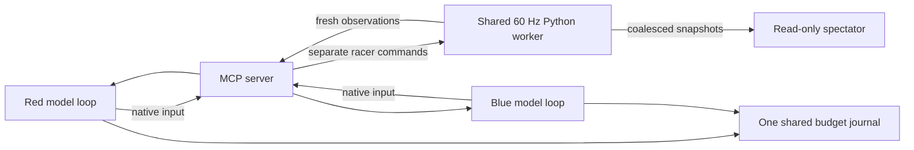

# Two model-controlled karts

The multiplayer prototype runs two independent decision loops against one
process-isolated Python physics clock. It retains the 24 m stadium, 12 m/s
speed ceiling, .12 rad maximum wheel angle and all 15 native controls.



The two inference loops may overlap. The clock continues while either model
is thinking, holding each kart's own previous input.

Start its spectator and actual Streamable HTTP MCP server:

```sh
env -u OPENROUTER_API_KEY .venv/bin/python -m mcpkart.duel_web --port 8766
```

Open `/` for the live view; `/?replay=featured` loads the featured saved race.
`/mcp` serves the tools below. The default replay root is
`artifacts/two-kart-session-v1`; use `--replay-root` for another archive. A cloud
machine's localhost address needs working forwarding to be accessible from your
own browser. Standalone replay HTML embeds its data and needs no API key or
network after loading. Managed browser policy may prevent opening `file:` URLs;
the identical page can be served locally. The solo server remains on port 8765.

## Run one match

Free practice uses an explicitly labeled scripted mock, not a model:

```sh
env -u OPENROUTER_API_KEY .venv/bin/python -m mcpkart.duel_run \
  --free --output artifacts/my-duel-free-v1
```

Each invocation runs one match and audits its recording after the clock stops.
Use a new output directory every time. `--course stadium_clockwise` selects the
mirror; `--grid staggered` changes the start. `--deadline` is at most 600 s.
The default live-status file matches the spectator's default replay root;
with a custom root, pass `--live-status YOUR_ROOT/live-status.json`. Spectator
status write failures are recorded as warnings and do not interrupt driving.

Qualify the local Linux shared clock before a newly authorized paid match:

```sh
env -u OPENROUTER_API_KEY .venv/bin/python -m mcpkart.duel_clock \
  --output artifacts/my-duel-clock-v1 --neutral-seconds 600
```

This runs four full free duels, checks actual physics advancement during a
350 ms HTTP-parent pause, then records and reconstructs the neutral run. It
binds source, server, process start, boot and saved evidence. Do not build,
run tests or perform heavy analysis while its clock is active. Its original
100 ms maximum lateness, 25 ms p95 and 100 ms drift limits remain. A changed
source/server/boot needs a new complete qualification.

All session paid windows are closed. For a future explicitly authorized,
prospectively specified match, the one-match command is:

```sh
.venv/bin/python -m mcpkart.duel_run \
  --paid --models jev jev \
  --clock-qualification artifacts/my-duel-clock-v1/qualification.json \
  --ledger artifacts/budget.json --output artifacts/my-paid-duel-v1
```

Set the OpenRouter key in the existing ignored environment/`.env`, never in
arguments. Use `--models jev openai` for the fixed mixed setup; the model order
is red then blue. Paid mode requires an existing cumulative ledger, takes one
root-writer lock, preserves its saved caps/charges/uncertainties, checks current
pinned route metadata and rejects stale qualification evidence. It performs no
automatic retry or replacement. It does not itself grant a new paid-study
authorization or replace the prospective native/interface checks. The frozen
0076–0078 helper windows must not be reused.

## Driver interface

1. `start_duel(seed, deadline, label, race_setup)` returns a race ID, an owner
   capability, and a separate driver capability and initial observation for
   each of `red` and `blue`.
2. Give each driver only its own capability. It calls
   `drive_duel(race_id, racer_id, driver_token, action_id, observation_tick,
   command_seq)` with one native action and an increasing sequence number.
   Acknowledgements identify the actual physics tick and include a fresh
   observation. `observe_duel(race_id, racer_id)` reads again without pausing.
3. Run those loops independently. Each may have one model request in flight;
   both may request simultaneously. Each kart holds its previous input during
   inference. A slow reply does not wait for, or delay, the other driver.
4. `finish_duel(race_id, owner_token, reason)` stops the race and collects the
   complete recording. The spectator can download the current recording after
   the race ends. Driver and owner capabilities are excluded from recordings
   and spectator state.

The [collector](../src/mcpkart/duel_bench.py) records exact questions, raw replies,
application ticks, routing identities and one shared budget transition chain.
Its free mode uses an explicitly labeled scripted mock; actual model collection
uses only returned native inputs. Each new paid study needs a finite frozen
registration and the current complete free timing qualification. The initial
session's authorization is [recorded here](experiments/0076-two-kart-session-authorization.json).

## Game mechanics and model information

Each kart is a circle of radius 1 m. Swept contact detection finds collisions
inside a physics tick. Equal-mass normal impulses with restitution .15 slow or
deflect the karts. The speed ceiling also applies after contact. Contact resolves
before gate credit and rescue; separation correction grants no progress.

The whole footprint must fit inside the road or gate span. Three continuous
seconds off-road triggers the existing stopped rescue behind the departure
point, with no checkpoint credit. Rescued karts are non-colliding for at least
one second and until separated. Finished karts stop and become non-colliding.
Both drivers may finish; finishes on the same physics tick tie.

The goal-only questions state the race objective, physical mechanics and
control descriptions. They supply current road measurements, body clearances,
race progress, and opponent position and relative velocity. Both heads receive
the opponent facts. Opponent x is forward and y is left in the driver's current
nose frame. Relative velocity means opponent minus own velocity. No passing
rule, avoidance threshold, racing line, suggested action or host fallback is
supplied. [Prompt construction](../src/mcpkart/duel_decisions.py).

An experimental programmatic `include_gate_geometry=True` profile adds only
the required gate's centre, road-edge endpoints and forward normal to the
wheel facts. The default is `False`; the pedal question and action rules are
unchanged. The [0079 pilot](experiments/0079-factual-next-gate-geometry.md)
did not establish a recovery benefit: one complete matched pair and a
provider-interrupted comparator, with no actual missed-gate recovery exposure.
The [0081 checkpoint benchmark](experiments/0081-recovery-benchmark.md) then
observed unassisted recovery in all twelve selected episodes under both
profiles. Its small added-delay time contrast does not establish a general
success-rate benefit; the default remains unchanged.

The [0082 harder bank](experiments/0082-harder-recovery.md) compared two new
recorded states at normal timing and +1 s added waiting, two repeats/cell. Both
profiles passed the post-contact state at normal latency and failed all severe
drift/delayed conditions. Both response cadences have legal free witnesses;
geometry did not improve success. Five new credits were required to avoid
counting inherited three-credit momentum as sustained recovery. Profiles and
game rules remain unchanged; all sixteen entries are closed.

The [0083 wheel-observability ablation](experiments/0083-wheel-observability.md)
adds optional programmatic `include_wheel_motion=True` and
`include_control_timing=True` collector flags; both default off. Motion copies
current speed, actual steering/yaw, held input and the existing road-lateral
velocity into the wheel question. Timing exposes the actual `added_delay_s`
as `post_response_wait_s`, including zero, and states that native response time
is additional and variable. The complete pedal question, rules and native
menus remain unchanged. Direct `duel_facts` construction uses
`include_wheel_motion=True, control_timing_s=1.0` (or `None` to omit timing).

On the frozen bank, delayed post-contact scores were baseline 0/2, motion 2/2,
timing 1/2, both 1/2. Severe drift remained unsolved. All four delayed successes
had a new contact and first brake reply; defaults are not promoted from these
small joint-profile results. All 28 entries are closed.

The [0084 motion-only validation](experiments/0084-motion-validation.md) then
repeated the original delayed state four times/profile and added two recorded
state holdouts. Both profiles scored 1/4, 0/2, 2/2 respectively, plus 3/3 normal
checks. The initial motion advantage did not repeat. Source was unchanged,
all 22 entries are closed, and the optional facts remain off by default.
Original successes again had first brake/new contact; the red holdout recovered
without either. These are state-specific associations, not supplied control
rules or an isolated mechanism.

The [0085 both-question timing study](experiments/0085-both-head-timing.md)
adds optional `include_pedal_timing=True` alongside `include_control_timing=True`
to copy the existing known-wait packet into both question factsets. The new
flag defaults to False and requires explicit declared timing. Direct construction
uses `duel_facts(..., control_timing_s=1.0, include_pedal_timing=True)`; use 0.0
for explicit zero scheduled wait. Native inference remains additional and unknown.
Only factual packets change; rules, criteria and native inputs stay fixed.
The 22-episode comparison did not improve recovery: delayed baseline 4/8 versus
timing 1/8, ordinary checks 3/3 each. All entries are closed; defaults remain off.

A rescue invalidates only its racer's older replies. A finished racer does not
stop the other loop. An invalid model reply stops collection and is preserved;
there is no retry or repair. Different model latency remains part of the race
conditions; decision frequencies are not artificially equalized.

## Reproducible recovery episodes

`DuelSimulation.checkpoint()` exports a validated full-precision JSON snapshot.
Pass it back as the optional `checkpoint` constructor argument with the same
static configuration. Both karts, original world clock, held input, gate/lap
progress, contact state and rescue/phase timers continue from that state. A new
race gets fresh capabilities and command queues. Historical HTTP requests are
not restored. Default starts and physics are unchanged.

The optional `episode={"racer_id": "red", "gate_credits": 3}` stops after that
many **new** target credits or the target's first new rescue. The terminal
recording reports an episode outcome, without marking an unfinished race as a
full finish. Deadlines and wall pacing run relative to the restored origin;
model measurements retain the original world tick/time. Rescues and grass must
be measured as deltas from the snapshot, not lifetime totals.

The [0081 state bank](experiments/0081-recovery-state-bank.json) includes exact
setup, original recording hash and audited prefix/continuation counts:

```python
import json
from pathlib import Path
from mcpkart.duel import DuelSimulation

bank = json.loads(Path("docs/experiments/0081-recovery-state-bank.json").read_text())
case = bank["missed_gate"]
sim = DuelSimulation(seed=case["seed"], **case["setup"])
assert sim.tick == 5133
```

Pass the same `case["setup"]` through MCP `start_duel`'s `race_setup` or the
programmatic collector's `setup`. The episode target is host measurement; it
is not added to the model's goal-only questions. The collector's explicit
`added_delay_s` option waits after a valid reply while physics and the previous
input continue; it submits the original native reply without refreshing the
observation. Default waiting is zero. This controls added waiting, not native
service latency. The closed 0081 helper is evidence and must not be reused to
open a new paid window.

## Replay and interpretation

The spectator distinguishes body footprints, current controls, next gates,
contact, rescues and finish order. Phased karts use dotted outlines. Live view
shows model identities and request latency while replay controls are disabled.
Replays support pause, scrubbing, speed selection and local recording import.
Event markers seek just before a contact, rescue, lead change or finish; the
result stays hidden until its recorded finish. Recorded model-call timelines
show latency and thinking where available, with a labeled summary otherwise.

Export a compact, self-contained replay without changing the master recording:

```sh
env -u OPENROUTER_API_KEY .venv/bin/python scripts/export_duel_replay.py \
  artifacts/my-paid-duel-v1/trial/race.json artifacts/my-duel-replay.html
```

The visual export defaults to 20 Hz, retains the last frame and strips private
capabilities/nonvisual metadata. Complete 60 Hz masters remain the evidence
for exact physics replay. Use `--stride 1` to retain every visual frame.
The archive reads a bounded `replays.json` manifest; malformed, missing and
external entries are skipped. The curated session archive contains both clean
races and examples with rescue or missed-gate detours.

Two clean finishes demonstrate a working shared-track race. Contact events and
lead changes demonstrate physical interaction, but do not alone establish that
a model reasoned about the opponent or intentionally overtook it. Recordings
and small cohorts should not be treated as robust win-rate estimates. Rescue-
assisted completions remain distinct from clean finishes. Zero rescues alone
does not establish a clean finish; time off-road also disqualifies it. Read the
[current findings](experiments/2026-10-22-two-kart-checkpoint.md) for all 24 duels.
